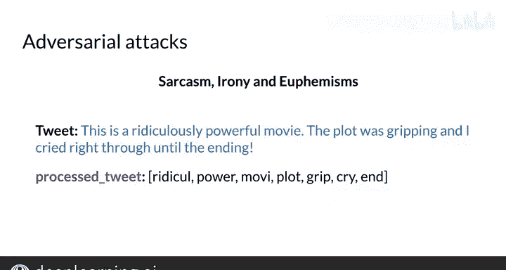

# 吴恩达《自然语言处理｜natural language processing》中英字幕 - P27：26_错误分析.zh_en - GPT中英字幕课程资源 - BV1Hc5ezDEWQ

No matter what NLP method you use， you will one day find yourself faced with an error， for example。

 a misclassified sentence in this video， I'll show you how to analyze such errors。

Let us consider some possible errors in the model prediction that can be caused by these issues。

 One semantic meaning lost in the preprocessing step 2。

 how word order affects the meaning of a sentence。 And three。

 some quirks of language has come naturally to humans was confused naive based models。

 So let's start。 One of your main considerations when analyzing errors in NLP systems is what the processed version of the text actually looks like。

Let's look at this tweet。 My beloved grandmother with some punctuation indicating a sad face。

 The sad face punctuation in this case， is very important to the sentiment of the tweet。

 because it tells you what's happening。😔，But if youre removing punctuation。

 then the processed tweet will leave behind only beloved grandmother。

 which looks like a very positive tweet。 My beloved grandmother exclamation mark。

 would be a very different sentiment。So remember， always check what the actual text looks like。

 It's not just about punctuation either。Check out this suite。

This is not good because your attitude is not even close to being nice。

If you remove neutral words like not and this， what you're left with is the following。 good attitude。

 close， nice from this set of words， and a classifier will infer that this is something very positive。

 I'll talk later on about handling nots and word orders。😊，But remember。

 double check what your process text looks like to make sure your model will be able to get an accurate read。

The I pipeline isn't the only potential source of trouble。 Look at these tweets。

I am happy because I did not go。 This is a purely positive tweet。

 I am not happy because I did not go with a negative sentiment。In this case。

 the knot is important to the sentiment。But gets missed by your naive based classifier。

 so word order can be as important as spelling。There are many other factors to consider as well。

 and you will see more and more ways to build systems that handle them in the weeks to come。

Another problem of naive base is something called an adversarial attack。

 The term adversarial attack describes some common language phenomena like sarcasm。

 irony and euphemism。Humans pick these up quickly， but machines are terrible at it。 This sweet。

 this is a ridiculously powerful movie。 The plot was gripping。

 and I cried right through until the ending。Contains a somewhat positive movie review。

 But preproces might suggest otherwise。 if you pre processcess this tweet。

 you'd get a list of mostly negative words。 But as you can see。

 they were actually used to describe a movie that the author enjoyed。

 if you use naive base on this list of words。 It would end up giving a very negative score regardless。

😊。

Now you know how to apply the naive based method to text classification。

 it makes the independence assumption which can lead to errors， but you know how to analyze them。

It's still a very powerful baseline， as you know， it relies on word frequency counts next week we can learn how to use word vectors that can give us better results。

