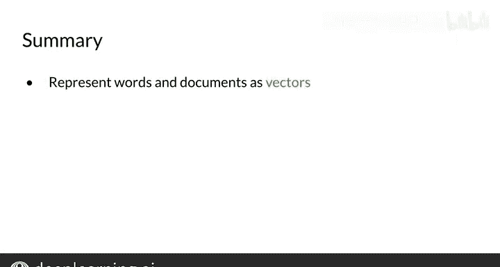

# 吴恩达《自然语言处理｜natural language processing》中英字幕 - P30：29_向量空间模型.zh_en - GPT中英字幕课程资源 - BV1Hc5ezDEWQ

Last week you learned about a classification algorithm known as naive Base this week you're going to learn about vector spaces and specifically you will learn what type of information these vectors could encode you will see different types of applications that you can use with these vector spaces and you'll see different types of algorithms you will be implementing Let's take a look at an example。

In this video， I'm going to introduce you to the general idea behind vector based models。

 you're going to see their advantages along with some of their applications in natural language processing。

So suppose you have two questions。 The first one is where are you heading and the second one is where are you from。

These sentences have identical words， except for the last ones。However。

 they both have a different meaning。On the other hand。

 say you have two more questions whose words are completely different。

But both sentences mean the same thing。Vectctor space models will help you identify whether the first pair of questions or the second pair are similar in meaning。

 even if they do not share the same words， they can be used to identify similarity for a question answering。

 paraphrasing and summarization。Vectctor space models will also allow you to capture dependencies between words。

Consider this sentence。 You eat cereal from a bowl here。

 You can see that the word cereal and the word bowl are related。 Now。

 let's look at this other sentence。You buy something and some one else sells it。

 So what it's saying is that someone one sells something because someone one else buys it。

 The second half of the sentence is dependent on the first half with vector based models。

 you will be able to capture this and many other types of relationships among different sets of words。

Vector space models are used in information extraction to answer questions in the style of who， what。

 where， how， and etc。In machine translation and in chatbot programming， they are also used in many。

 many other applications。As a final thought， I'd like to share with you this quote from John Firth。

 a famous English linguist。You shall know a word by the company it keeps。

 This is one of the most fundamental concepts in NLP。When using vector space models。

 the way that representations are made is by identifying the context around each word in the text。

 and this captures the relative meaning。U recap， vector space models allow you to represent words and documents as vectors。

This captures the relative meaning。You learn about vector space models。

 and you have seen different types of applications where these vector space models are used。

In the next video， you will build them from scratch。

 and specifically you will see how they are built using coence matrices。

