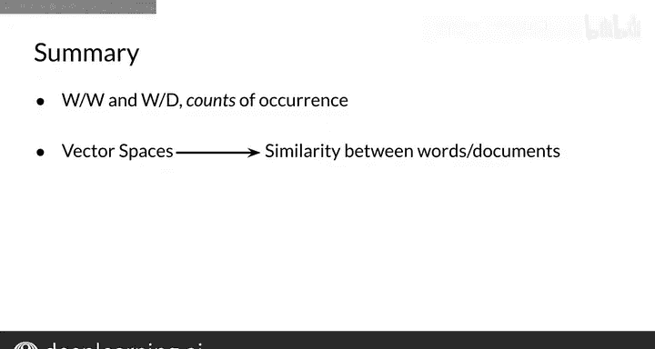

# 吴恩达《自然语言处理｜natural language processing》中英字幕 - P31：30_词对词与词对文档.zh_en - GPT中英字幕课程资源 - BV1Hc5ezDEWQ

In this video， you will learn how you can construct your vectors based off a conce matrix。

 specifically depending on the task you're trying to solve， you can have several possible designs。

 You will also see how you can encode a word or a document as a vector。

 Let me show you how you can do this。

To get a vector space model using a word by word design。

 youll make a corence matrix and extracts vector presentations for the words in your corpus。

 You' will be able to get a vector space model using a word by document design using a similar approach。

Finally， I'll show you how in a vector space you can find relationships between words and vectors。

 also known as their similarity。The conce of two different words is the number of times that they appear in your corpus together within a certain word distance。

 K。For instance， suppose that your corpus has the following two sentences。

The row of the cocurnce matrix corresponding to the word data with a k value equal to 2 would be populated with the following values。

For the column corresponding to the word simple， you'd get a value equal to2。

 because data and simple go occur in the first sentence within a distance of one word。

 And in the second sentence within a distance of two words。

 the row of the conce matrix corresponding to the word data would look like this if you consider the cocurnce with the words simple。

 raw， like and I。In this case， the vector representation of the word datata would be equal to 21，10。

With a word by word design， you can get a representation with n entries with n between one and the size of your entire vocabulary。

For a word by document design， the process is quite similar。 In this case。

 you'll count the times that words from your vocabulary appear in documents that belong to specific categories。

For instance， you could have a corpus consisting of documents between different topics like entertainment。

 economy and machine learning。Here you'd have to count the number of times that your words appear on the documents that belong to each of the three categories in this example。

 suppose that the word data appears 500 times in documents from your corpus related to entertainment。

6620 times in economy documents。And 9320 in documents related to machine learning。

The word film appears in each document category 7000，4000 and 1000 times respectively。

 Can you get a sense of where this is going already。

Once you've constructed the representations for multiple sets of documents or words。

 you will get your vector space。 Let's take the matrix from the last example。Here。

 you could take a representation for the words data and film from the rows of the table。However。

 I'll take the representation for every category of documents by looking at the columns。

 So the vector space will have two dimensions。 The number of times that the words data and film appear on the type of document for the entertainment corpus。

 you'd have the following vector representation。This one for the economy category。

 and that for the machine learning category Note that in this space。

 it is easy to see that the economy and machine learning documents are much more similar than they are to the entertainment category。

Coming up soon， you will make comparisons between vector representations using the cosine similarity and the Euclidean distance in order to get the angle and distance between them。

So far， you've seen how to get vector spaces by two different designs。

Word by word and word by documents by either counting the conce of words or the conce of words in the documents corporal。

I also showed you that in vector spaces， you can determine relationships between types of documents like similarity。

Now you're becoming more and more familiar with these vector spaces。

 you've seen several possible designs that you can use to solve a specific task。

You've also seen how you can encode words or tweets as vectors in the next video you will learn about a new similarity metric that will allow you to compare these two vectors the similarity metric is known as the Euclidean distance。

