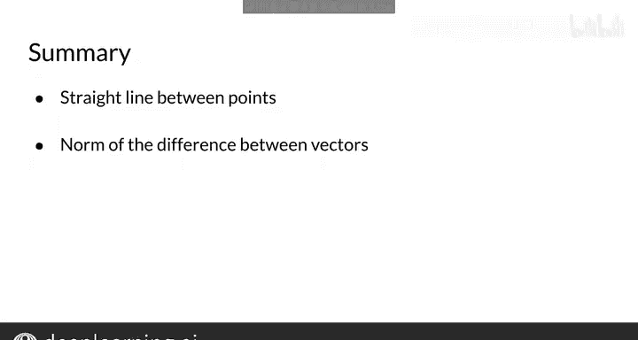

# 吴恩达《自然语言处理｜natural language processing》中英字幕 - P32：31_欧几里得距离.zh_en - GPT中英字幕课程资源 - BV1Hc5ezDEWQ

Hello in this video you're going to learn about Euclidean distance， which is a similarity metric。

 this metric allows you to identify how far two points or two vectors are apart from each other。

During this segment， you will get the Euclidean distance between two document vectors。

 like the ones from the previous video， and then generalize that notion to vector spaces in higher dimensions。

Let's use two of the corpora vectors you saw previously。Remember， in that example。

 there were two dimensions。 The number of times that the word data and the word film appeared in the corpus。

 Corpus A will be the entertainment corpus and corpus B will be the machine learning corpus。 Now。

 let's represent those vectors as points in the vector space。

The Euclidean distance is the length of the straight line segment connecting them。To get that value。

 you should use the following formula。 The first term is their horizontal distance squared。

And the second term is their vertical distance squared。 As you see。

 this formula is an example of the Pythagoreian theorem。

 If you saw for each of the terms in the equation， you should arrive at this expression。And at last。

 get a Euclidean distance approximately equal to 10667。

 Feel free to pause the video and check this process。When you have higher dimensions。

 the Euclidean distance is not much more difficult。

 Let's walk through an example using the following cocurnce matrix。

 Suppose that you want to know the Euclidean distance between the vector V of the word ice cream and the vector representation W of the word boba to start。

 you need to get the difference between each of their dimensions。 square those differences。

 sum them up and then get the square roots of your result。

 This process is the generalization of the one from the last slide。

 This is the formula that you would use to get the Euclidean distance between vector representations on an n dimensionmenional vector space。

 If you remember from algebra。 This formula is known as the norm of the difference between the vectors that you are comparing。

Let's take a look at the implementation of the Euclidean distance in Python。

 If you have two vector representations like the ones from the previous example。

 you can use the lean alg module from numpy to get the norm of the difference between them。

If you implement this code in Python， you should get these results。

 the norm function works for n dimensional spaces。The primary takeaways here are that the Euclidean distance is basically the length of the straight line that connects to vectors。

And that to get the Euclidean distance， you have to calculate the norm of the difference between the vectors that you are comparing by using this metric。

 you can get a sense of how similar to documents or words are。

Now that you have learned Euclidean distance in the next video。

 I'll show you a different type of similarity function concretely I'll show you the cosine similarity function。

 which is one of the most popular similarity functions see you in the next video。

