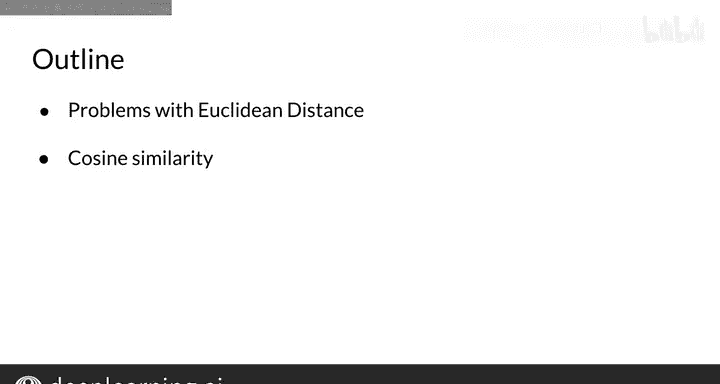
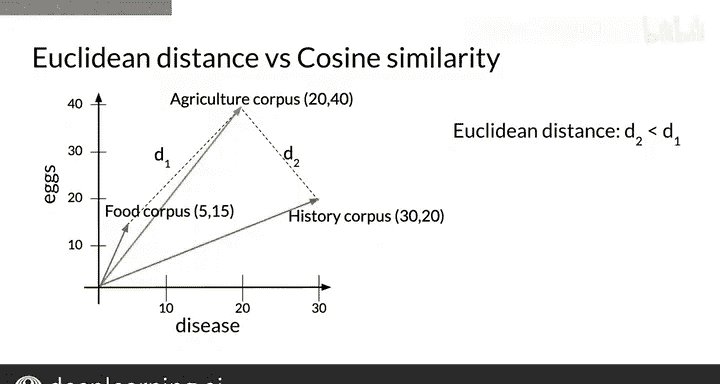
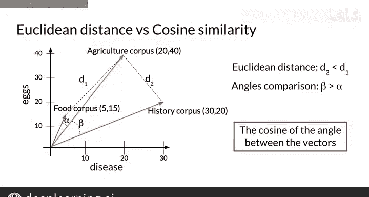
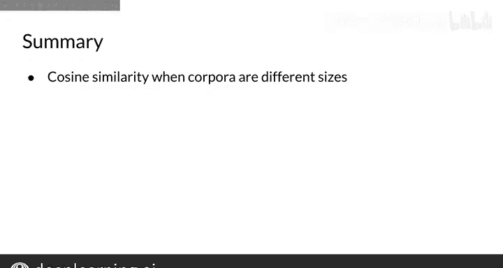

# 吴恩达《自然语言处理｜natural language processing》中英字幕 - P33：32_余弦相似度直觉.zh_en - GPT中英字幕课程资源 - BV1Hc5ezDEWQ

In this video， you're going to learn about cosine similarity。

 which is another type of similarity function。It basically makes use of the cosine of the angle between two vectors。

 and based off that， it tells you whether two vectors are close or not。In this section。

 you will see the problem of using Euclidean distance。

 especially when comparing vector representations of documents or corporal。

 and how the cosine similarity metric could help you overcome this problem。

To illustrate how the Euclidean distance might be problematic， lets take the following example。

 Suppose that you are in a vector space where the corpora are represented by the occurrence of the words disease and eggs。

 Here is the representation of a food corpus。An agricultural corpus。And a history corpus。

 each one of these corpora have texts related to that subject。

 But you know that the word totals in the corpora differ from one another。 In fact。

 the agriculture and the history corpus have a similar number of words。

 While the food corpus has a relatively small number。

Let's define the Euclidean distance between the food and the agriculture corpus as d1。

 and let the Euclidean distance between the agriculture and the history corpus be D2。As you can see。

 the distance D2 is smaller than the distance D1， which would suggest that the agriculture and history corporal are more similar than the agriculture and food corporal。

 Another common method for determining the similarity between vectors is confusing the cosine of their inner angle。

 if the angle is small， the cosine would be close to 1， and as the angle approaches 90 degrees。

 the cosine approaches 0。

As you can see here。The angle alpha between food and agriculture is smaller than the angle beta between agriculture and history。

In this particular case， the cosine of those angles is a better proxy of similarity between these vector representations than their Euclidean distance。

Now， you're familiar with the main intuition behind the use of the cosine similarity as a metric to compare the similarity between two vector representations。

 Remember that the main advantage of this metric over the Euclidean distance is that it isn't biased by the size difference between the representations。

 So， youll get the chance to actually calculate this metric。

In this video， you learned why the cosine similarity metric is useful。

If you have two documents of very different sizes， then taking the Euclidean distance is not ideal。

 The cosine similarity used the angle between the document。

 and is thus not dependent on the size of the corpusees。

