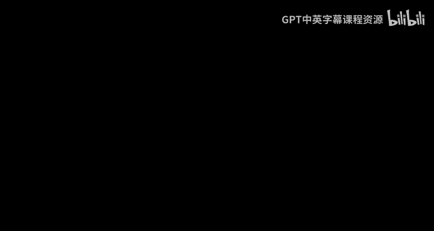
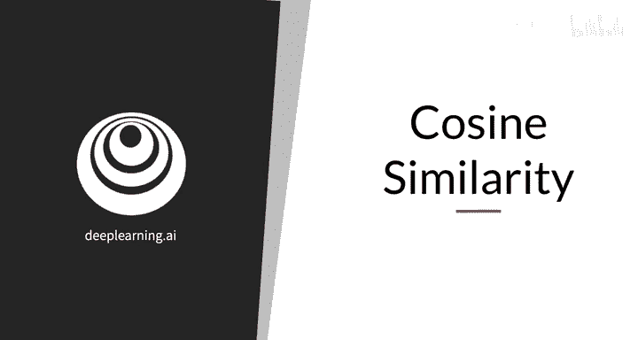
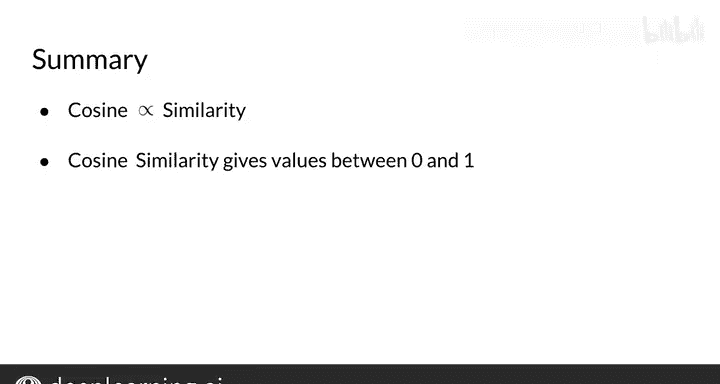

# 吴恩达《自然语言处理｜natural language processing》中英字幕 - P34：33_余弦相似度.zh_en - GPT中英字幕课程资源 - BV1Hc5ezDEWQ

In this video you will learn how to compute the dust products between two vectors and how to compute the norm Once you know how to do these two things。

 you'll be able to compute the cosine similarities score。

Now that you have the intuition behind the use of cosine of the angle between two vector representations as a similarity metric。

 I'll go deeper into an explanation and then show you how to calculate the cosine similarity metric in this section you will get the cosine of the inner angle of two vectors。

 then I'll show you how the value of the cosine similarity is related to the similarity of the directions of two vectors。

First， you have to recall some definitions from algebra。

 The norm of a vector or its magnitude is written like this。

 It's defined to be the square root of the sum of its elements squared。

The dust products between two vectors is the sum of the products between their elements in each dimension of the vector space。

Let's take another look at two of the corpora from the last section。 Remember that in this example。

 you have a vector space where the representation of the corpora is given by the number of occurrences of the words disease and x。

 The angle between those vector representations is denoted by beta。

 The agriculture corpus is represented by the vector V。

 and the history corpus is going to be vector W。The dot product between those vectors is defined as follows from this equation。

 you see that the cosine of the angle beta is equal to the dot product between the vectors divided by the product of the two norms。

Replacing the actual values from the vector representations should give you this expression。

In the en numerator， you have the product between the occurrences of the words disease and eggs。

 and in the denominator， you have the product between the norm of the vector representations of the agriculture and history corporal。

 ultimately you should get a cosine similarity of 0。87。

Feel free to pause and do the calculations yourself。

But what does this metric tell you about the similarity of two different vectors。

 Consider when two vectors are orthogonal in the vector spaces that you know so far。

 it is only possible to have positive values for any dimension。

 So the maximum angle between pair of vectors is 90 degrees。In that case。

 the cosine would be equal to 0， and it would mean that the two vectors have orthogonal directions or that they are maximally dissimilar。

Now， let's look at the case where the vectors have the same direction。 In this case。

 the angle between them is 0 degrees。And the cosine is equal to1， because cosine of 0 is just one。

As you can see， as the cosine of the angle between two vectors approaches1。

 the closer their directions are。Now， you know how to get the cosine similarity between any pair of vectors。

 An important takeaway is that this metric is proportional to the similarity between the directions of the vectors that you are comparing。

And that for the vector spaces you've seen so far， the cosine similarity takes values between 0 and 1。

To recap you have learned to compute the cosine similarity score between two vectors for deposit vectors you have seen so far the score is bounded between 0 and1 Now that if you were to take the cosine similarity score of a vector with itself you will get one if the vectors are perpendicular it will give you zero so similar vectors have higher scoress。

