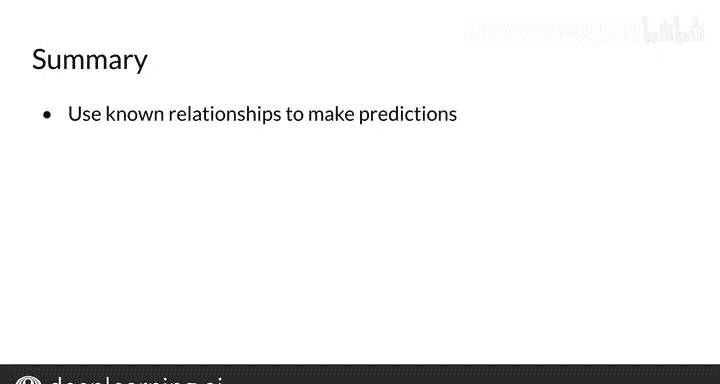

# 吴恩达《自然语言处理｜natural language processing》中英字幕 - P35：34_在向量空间中操作词.zh_en - GPT中英字幕课程资源 - BV1Hc5ezDEWQ

Hello， in this video you're going to learn to manipulate vectors by performing some simple vector arithmetic。

 meaning by adding vectors or subtracting vectors， you will be able to predict the countries of certain capitals let's dive in。

I'll show you how to manipulate vector representations in order to infer unknown relations among words。

Suppose that you have a vector space with countries and their capital cities。

 You know that the capital of the United States is Washington， D C。

 and you don't know the capital of Russia， but you'd like to use the known relationship between Washington D。

 C and the USA to figure it out for that。 you'll just use some simple vector algebra。

For this example， you are in a hypothetical two dimensional vector space that has different representations for different countries and capital cities。

First， you will have to find the relationship between the Washington DC and USA vector representations。

 in other words， which vector connects them to do that， get the difference between the two vectors。

 the values from that will tell you how many units on each dimension you should move in order to find a country's capital in that vector space。

 so to find the capital city of Russia， you will have to sum its vector representation with the vector that you also got in the last step。

At the end， you should deduce that the capital of Russia has a vector representation of 10 comma 4。

However， there are no cities with that representation。

 so you'll have to take the one that is the most similar to it by comparing each vector with the Euclidean distances or cosine similarities。

In this case， the vector representation that is closest to the 0。

10 comma 4 is the one for Moscow using the simple process。

 you could have predicted the capital of Russia if you knew the capital of the USA。

 the only catch here is that you need a vector space where the representations capture the relative meaning of words。

Now， you have a simple process to get unknown relationships between words by the use of known relationships between others。

 You now know the importance of having vector spaces where the representations of words capture the relative meaning in natural language In upcoming parts of this specialization。

 You will perform more sophisticated tasks， taking advantage of this type of representation。

 You have now seen a clustering of all vectors when plotted on two axes。

 You have also seen that the vectors of the words that occur in similar places in the sentence will be encoded in a similar way。

You can take advantage of this type of consistency encoding to identify patterns， for example。

 if you have the word doctor and you are to find the closest words that are closest to it by computing cosine similarity。

 you might get the word doctors， nurse， cardiologist， surgeon， etc。In the next video。

 you will learn how to plot these D dimensionsional vectors on a 2 D plane。

