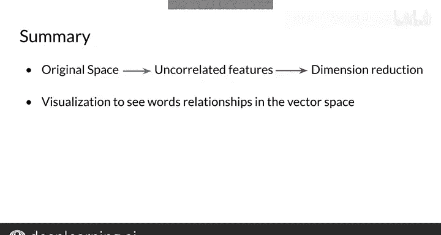

# 吴恩达《自然语言处理｜natural language processing》中英字幕 - P36：35_可视化与PCA.zh_en - GPT中英字幕课程资源 - BV1Hc5ezDEWQ

It is often the case that you'll end up having vectors in very， very high dimensions。

 You want to find a way to reduce the dimension of these vectors to two dimensions so you can plot it on an X Y axis。

You will now learn about principal component analysis， which will allow you to do so。

 You are going to be using principal component analysis to visualize vector representations with higher dimensions than the ones that you've seen plotted so far。

 to get started， I'll give you some intuition on the motivation for visualizing vector representation of words。

 and you will see for yourself what principal component analysis Thus。

 and how it is used for dimensionality reduction。Imagine you have the following representation for your words in a vector space In this scenario。

 your vector space dimension is higher than2。 You know that the words oil and gas and city in town are related。

 and you want to see if that relationship is captured by the representation of your words。

 So how could you visualize your words in order to see this and other possible relationships。

Dimenssality reduction is a perfect choice for this task when you have a representation of your words in a high dimensional space。

 you could use an algorithm like PCA to get a representation on a vector space with fewer dimensions。

If you want to visualize your data， you can get a reduced representation with three or fewer features。

If you perform principal component analysis on your data and get a two dimensional representation。

 you can then plot a visual of your words。In this case。

 you might find that your initial representation captured the relationship between the words oil and gas。

And city and town， Because in your two dimensional space。

 they appear to be clustered with related words。You can even find other relationships among your words that you didn't expect。

 which is a fun and useful possibility。Now that you know what PCA can help you achieve。

 let's go into detail on how it works for the sake of simplicity。

 I'll begin with a two dimensional vector space， say that you want your data to be represented by one feature instead using PC first youll find a set of uncorrelated features。

And then project your data to a1 dimensional space trying to retain as much information as possible。

As you can see， this process is quite straightforward。Coming up。

 you will see for yourself the details of how this algorithm works。

 along with how to get uncorrelated features， youll also project your data for a representation in a lower dimension while retaining as much information as possible。

Let's do a quick review before you go。 PCA is an algorithm used for dimensionality reduction that can find uncorrelated features for your data。

It's very helpful for visualizing your data to check if your representation is capturing relationships among words。

You learned how to visualize components using PCA， so given any D dimensionsional vector。

 you can transform it into two dimensions and then you can create a plot in the next video we will go over how the algorithm actually works。

