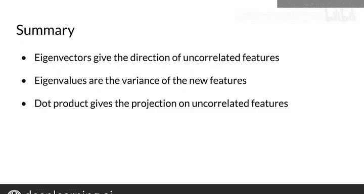

# 吴恩达《自然语言处理｜natural language processing》中英字幕 - P37：36_PCA算法.zh_en - GPT中英字幕课程资源 - BV1Hc5ezDEWQ

You will now learn about eigenvalues and eigenvectors。

 and you will see how you can use them to reduce the dimension of your features。First。

 I'll show you how to get uncorrelated features for your data。

 and then how to reduce the dimensions of your word representations while trying to keep as much information as possible from your original embedding。

To perform dimensionality reduction using PC， begin with your original vector space。

 Then you get uncorrelated features for your data。 and finally。

 you project your data to a number of desired features that retain the most information。

You may recall from algebra that matrices have eigenvectors and eigenvalues。

 You do not need to remember how to get those right now， but you should keep in mind that in PC。

 they are useful because the eigenvectors of the covariance matrix from your data。

 they give directions of uncorrelated features and the eigenvalues are the variances of your dataset sets in each of those new features so to perform PC。

 you will need to get the eigenvectors and eigenvalues from the covariance matrix of your data。

The first step is to get a set of uncorrelated features。For this step。

 you will mean normalize your data。Then get the covariance matrix and finally perform a singular value decomposition to get a set of three matrices。

The first of those matrices contain the eigenvectors stacked column Y。

 and the second one has the eigenvalues on the diagonal。

 The singular vector decomposition is already implemented in many programming libraries。

 So you don't have to worry about how it works。The next step is to project your data to a new set of features。

 you will be using the eigenvectors and eigenvalues in this step。

Let's denote the eigenvectors with U and the eigenvalues with S。First。

 you will perform the do products between the matrix containing your word embeddings and the first and columns of the U matrix。

 where n equals the number of dimensions that you want to have at the end。For visualization。

 it's common practice to have two dimensions。Then you will get the percentage of variances retained in the new vector space as an important side note。

 your eigenvectors and eigenvalues should be organized according to the eigenvalues in descending order。

 This condition will ensure that you retain as much information as possible from your original embedding。

However， most libraries order those matrices for you。Wrapping up。

Eigenvectors from the covariance matrix of your normalized data give the directions of uncorrelated features。

 The eigenvalues associated with those eigenvectors tell you the variance of your data on those features。

 The dust products between your word embeddings and the matrix of eigenvectors will project your data onto a new vectorctor space of the dimension that you choose。

You are now ready to implement PC A in this week's assignment to visualize word representations。

 Good luck with that。 And remember to have fun。😊。

Congratulations， you now know all about PCA and you know all the steps required for you to implement it next week。

 youll learn about vector spaces and I'll show you how you can use them to build a simple machine translation system。

