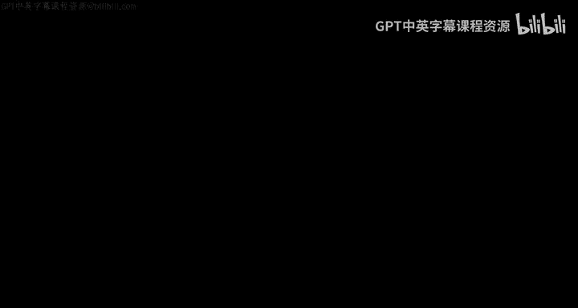
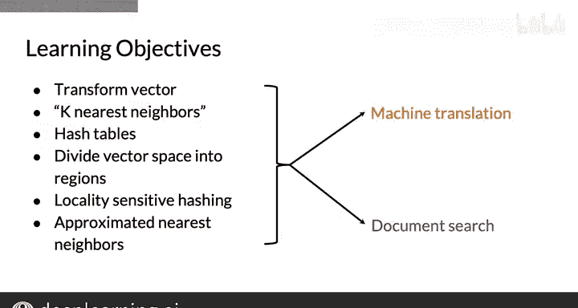

# 吴恩达《自然语言处理｜natural language processing》中英字幕 - P40：39_概述.zh_en - GPT中英字幕课程资源 - BV1Hc5ezDEWQ

Congratulations for making it to the final week of the course。

 I will now tell you what you're about to learn。In this fourth and final week of this course。

 you will learn to implement machine translation to translate the English word Ho to the French word Bonjou。

You will also learn to implement document search。 For example， given a document such as the sentence。

 can I get a refund， you can search for similar documents such as what's your return policy。

 or may I get my money back。 You will learn a set of skills that you can apply to both of these useful NLP tasks。

 Here is a preview of the skills that you will practice in this week's lectures and assignment。

 Don't worry if you do not understand what some of these mean right now。

 you will learn about each of these and get some practice before you move on to the assignment。First。

 you will learn about what it means to transform a vector， such as a word vector。

You will learn how to implement Ken nearest neighbors， which is a way of searching for similar items。

You'll learn about hash tables， which will help you assign your word vectors into subsets。

Then you will learn how to divide the vector space into regions again。

 don't worry if you don't understand what this means at this point。

 you'll get some visual understanding of what this means and how it can help you improve search for similar words。

 Finally， youll know how to implement locality sensitive hashing。

 which helps you perform approximatelyally nearest neighbors。

 an efficient way of searching for similar word vectors。

By practicing how to find similar word vectors， you will effectively know how to implement machine translation and document search。

 This is very exciting material， and we hope that you will really enjoy what you will learn this week。

😊。

Now that you have an overview of what you are about to learn and the learning objectives of the week。

 we can go ahead and get started。😊。