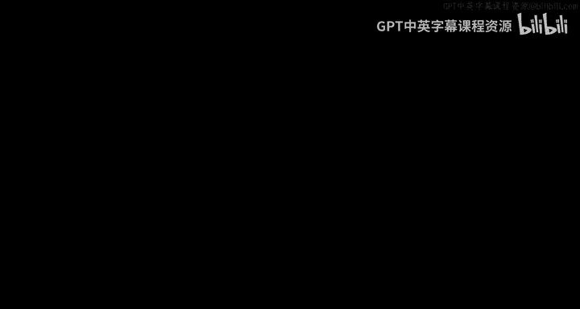
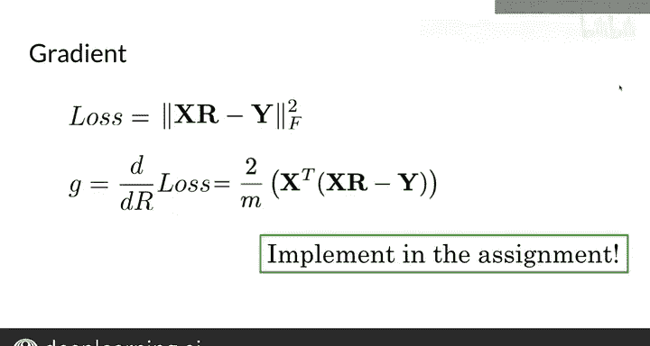

# 吴恩达《自然语言处理｜natural language processing》中英字幕 - P41：40_词向量转换.zh_en - GPT中英字幕课程资源 - BV1Hc5ezDEWQ

Last video you learned about word vectors and you saw that they can capture important properties of words this week you will make use of word vectors to learn to align words in two different languages which will give you your first basic translation program Later I'll teach you locality sensitive hashing to speed it up。

Let's first get an overview of machine translation by starting with an example of English to French translation in order to translate an English word to a French word。

 one way would be to generate an extensive list of English words and their associated French word。

If you ask the human to do this， you would find someone who knows both languages to start making a list。

If you want a machine to learn how to do this， you would calculate word embeddings associated with English and word embeddings associated with French。

Next， retrieve the English word embedding of a particular English word， such as cat。

Then find some way to transform the English word embedding into word embedding that has a meaning in the French word vector space。

We will see how to convert from the English word vector space to the French word vector space in a moment。

Next， you will take the transformed word vector and search for word vectors in the French word vector space that are most similar to it。

The most similar words are candidate words for your translation。 If your machine does a good job。

 it may find the word Shah， which is the French word for cats。

 You'll want to find a matrix that can do this transformation for you。

 So let's talk about transforming vectors using matrices。To try this out for yourself。

 you can write the following code， which is also in the notebook associated with this lecture。

Define the matrix R， then define the vector x， multiply x by R using nupy dot。

 and the result is another two dimensional vector， which is what you saw earlier。

Please try this out for yourself。 Now that we know that there can be a matrix that transforms our English word vectors into relevant French word vectors。

How do we define this transformation matrix， which we'll denote as R。

 We can start with a randomly selected matrix R and then see how it performs when you try to translate the English vectors in matrix X。

 and compare that to the actual French word vectors， which is in the matrix Y。

 in order for this to work， you will first need to get a subset of English words and their French equience。

 get the respective word vectors， and stack the word vectors in the respective matrices， X and Y。

 The key here is to keep the rows lined up or to align the word vectors。

 This means that if the first row of matrix X contains the word cat。

 then the first row of the matrix Y should contain the French word for cat。

 which is Sha Now you may be asking， wait a minute。

 if I already have the English words and their French translations。

 Why do I need to train a model to do this。 Why not just save this information in a key value mapping like a Python dictionary。

 Well， the nice thing is that you。😊，Can just collect a subset of these words to find your transformation matrix。

And if it works well， then the model can be used to translate words that are not part of your original training set。

 So you only need to train on a subset of the English French vocabulary and not the entire vocabulary。

So let's see how to find a good matrix R。 First， we compare the translation X times R with the actual French word embeddings in Y。

 We do this by taking the x matrix times the R matrix and subtracting the y matrix。

 I'll explain in more detail what this expression means and also what this capital F subscript means。

 But for now， think of it as a measure of how far apart the attempted translation and the actual French vectors R。

 If you start with a random matrix R。 you can gradually improve this matrix R in a loop。 First。

 compute the gradient by taking the derivative of this loss function with respect to the matrix R。

 Next， update the matrix R by subtracting the gradient。😊。

But note that it's the gradient weighted by the learning rate alpha。

 You can either pick a fixed number of times to go through the loop or check the loss at each iteration and break out of the loop when the loss falls between a certain threshold。

Now， let's explain what this notation with the double vertical lines means。

 This is measuring the magnitude or the norm of a matrix。

 Let's see an example of calculating this norm and then see the general formula。

 Let's say that the result of x times R minus y is a matrix。

 we'll pretend for this example that there is only two words in this dictionary。

 which is the number rows in the matrix。 And the word embeddings have two dimensions。

 So that's the number of columns in the matrix。 So matrices x R y and a are all two by two matrices。

 If the matrix a looks like this。 then to calculate its norm。

 we take two squared plus two squared plus two squared plus two squared。 then take square roots。

 This gives us 4。😊，Here's the actual formula。 You just take all the elements in the matrix。

 square them and add them up。 This norm has the subscript F， because this is called the Fbinius norm。

Now， let's calculate the ferbeus norm in code。 You start with a matrix a。

Use nuy dot square to square all the elements， then use nuumpy dot sum。

 then nuy dot square roots to get4。Try it out for yourself。Not that in practice。

 it's easier to minimize the square of the Fbeus norm。 In other words。

 we can cancel out the square root by taking the square。

 I'll explain in a moment why it's easier to work with the square of the norm。

 If we go back to our example with matrix A。 The squared forbeus norm is just two squared plus two squared plus two squared plus2 squared。

 Then we take the square root， But then cancel it out by squaring that sum。

 So the square of the Fbeus norm is 16。😊，Now， let's also go into detail on how you can calculate the gradients of the loss function。

 The loss is defined as the square of the Forbenus norm。The gradient is the derivative。

 the loss with respect to the matrix R。 If it looks like this。

 the scalar M is the number of rows or words in the subset that were using for training。

 If you remember from calculus， this may look familiar to you if you pretend that R is a single variable instead of a matrix。

 an x and Y R constants。 If you don't recognize this。 don't worry。

 you won't need to know calculus here。 you will be able to look up these derivatives online if you ever need to。

Now， going back to why it helps to use the square of the Ferbius norm。

 it's easier to take the derivative of this expression。

 rather than dealing with the square root that's in the Ferbeus norm。

 You will implement this formula in the assignment。

You have seen how with just one matrix， you can learn to align word vectors from one language to another。

We will next look at Ken neighbors。