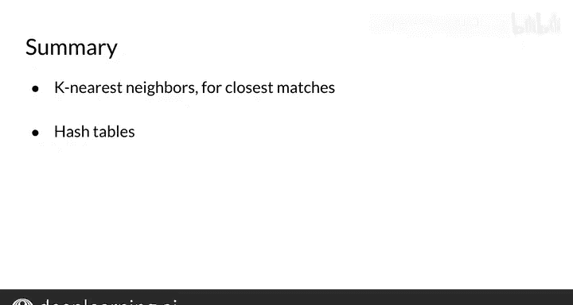

# 吴恩达《自然语言处理｜natural language processing》中英字幕 - P42：41_K近邻.zh_en - GPT中英字幕课程资源 - BV1Hc5ezDEWQ

One key operation needed to find a matching word in the previous video was finding the key nearest neighbors of a vector。

We will focus on this operation in the next few videos as it's a basic building block for many NLP techniques。

 Notice that a transformed word vector after the transformation of its embedding through an R matrix would be in the French word vector space。

 but it is not going to be necessarily identical to any of the word vectors in the French word vector space。

You need to search through the actual French word vectors to find a French word that is similar to the one that you created from the transformation。

 You may find words such as Salu or Bonjou。 which you can return as the French translation of the word hello。

 So the question is。How do you find similar word vectors。

To understand how to find similar word vectors， let's look at a related question。

 How do you find your friends who are living near， Let's pretend that you are visiting San Francisco in the United States and yourre visiting your dear friend。

 Andrew。You also want to visit your other friends over the weekend。 preferably。

 those who live nearby。 One way to do this is to go through your address book and for each friend。

 get their address， calculates how far they are from San Francisco。So one friend is in Shanghai。

 The other friend is in Bangalore， and another friend is in Los Angeles。

 You can sort your friends by their distances to San Francisco， then rank them by how close they are。

Notice that if you have a lot of friends， which I'm sure you do。

 This is a very time intensive process。 Is there a more efficient way to do this。

Notice that two of these friends live in another continent。

While the third friend lives in the United States， could you have just searched for a subset of friends who live in the United States？

You might have realized that it may not have been necessary to go through all of your friends in your address in order to find the ones closest to you。

 You might have imagined if you somehow could filter on which friends were all in a general region。

 such as North America， then you could just search within that subgroup of friends。

 If there is a way to slice up the geographic space into regions。

 you could search just within those regions。 when you think about organizing subsets of a dataset sets efficiently。

 you may think about placing your data into buckets。 If you think about buckets。

 Then youll definitely want to think about hash tables。

Hash tableables are useful tools for any kind of work involving data。

And you'll learn about hash tables， next。In this video， I showed you how using Can nearest neighbors。

 you could translate a word， even if its transformation doesn't exactly match the word embedding in the desired language。

 and I introduced you to hash tables， a useful data structure that you will learn about in the next video。

Great， now you are ready to learn about hashing， this is an effective technique that would allow you to look up queries in a much faster way than simple linear search。

😊。