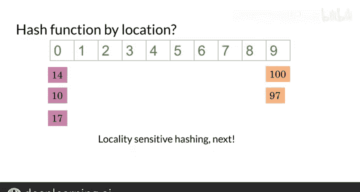

# 吴恩达《自然语言处理｜natural language processing》中英字幕 - P43：42_哈希表与哈希函数.zh_en - GPT中英字幕课程资源 - BV1Hc5ezDEWQ

In this video you are going to learn about hash tables and hash functions， for example。

 imagine that you have a cupboard with several drawers you might want to place similar objects in similar drawers。

 for example， paper documents alone， keys alone and books alone。In this video。

 we will dive deeper into this concept。So let us say you have several data items and you want to group them into buckets by some kind of similarity。

 One bucket can hold more than one item， and each item is always assigned to the same bucket。

So the result would be these blue ovals end up in bucket number one。

 these gray rectangles end up in bucket number 2， and these magenta triangles are assigned to buckets 3。

Now let's think about how we'd like to do this with word vectors。First。

 let's assume that the word vectors have just one dimension instead of 300 dimensions。

So each word is represented by a single number， such as 100。141710 and 97。

You need to find a way to give each vector a hash value。

 which is a key that tells it which bucket it's assigned to。

A function that assigns a hash value is called a hash function。In this example， here is a hash table。

 which is a set of buckets。 In this case， the hash table has 10 buckets。 Notice how the word vectors。

 hundred and 10 are assigned to bucket 0。 The word vector 14 is assigned to bucket 4。

 and the word vectors 17 and 97 are assigned to bucket 7， Do you notice a pattern。

This formula here is the hash function that's being used to assign the word vectors to their respective buckets。

The modo operator takes the remainder after dividing by 10。

The remainder is the hash value that tells us where the word vector should be stored。 For example。

14 divided by 10 has a remainder of 4， so it goes to buckets 4。Now let's build a basic hasling code。

Here is the definition of a function that takes in the list of values。

 You can think of each value as a one dimensional vector。It also takes in the number of pockets。

Deeffinine the hash function used in the modular operator。Then you create the hash table。

Notice that this is a dictionary comprehension。 The key is an integer。

 and the value is an empty lists， which youll use as a bucket for storage。For each word vector。

 calculate its hash value， then append it to the appropriate list。

The highable that is returned can be seen in the notebook that goes with this lecture。

You'll see that the hash table is the same as what you saw on the previous slide。Now。

 let's take another look at this basic hash table。 recall that your original goal was to put similar word vectors into the same bucket。

But here it doesn't look like numbers that are close to each other are in the same bucket。

For instance，10，14 and 17 are in different buckets。Ideally。

 you want to have a hash function that puts similar word vectors in the same buckets like this。

To do this， you'll need to use what's called locality sensitive hashing。

Looccalality is another word for location。 Sensitive is another word for caring。

So locality sensitive hashing is a hashing method that cares very deeply about assigning items based on where they' are located in vector space。

You'll learn about locality sensitive hashing next。

So you learned a lot of new terms， you learned about hash values， hash functions and buckets。

 you have also seen the code for how to build a hashable or the equivalentence of the coverboard I spoke about in the intro of the video in the next video we will look at locality sensitive hashing。

