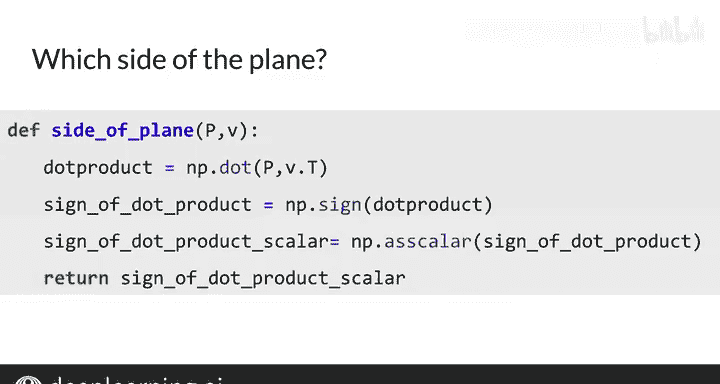

# 吴恩达《自然语言处理｜natural language processing》中英字幕 - P44：43_局部敏感哈希.zh_en - GPT中英字幕课程资源 - BV1Hc5ezDEWQ

One key method that you will use to reduce the computational cost of finding k nearest neighbors in high dimensional spaces is locality sensitive hashing。

In this video， I will teach you what hashes are and where they are used to start thinking about locality sensitive hashing。

 let's first assume that you are using word vectors with just two dimensions。 All repeats。

 each vector as a circle instead of arrows。 So let's say you want to find a way to know that these blue dots are somehow close to each other。

 and that these gray dots are also related to each other。😊，First。

 divide the space using these dashed lines。Which I'll call planes。

 I'll explain why I call them planes in a bit。Notice how the blue plane slices up the space into vectors that are above it or below it。

The blue vectors all happen to be on the same side of the blue plane。Similarly。

 the gray vectors happened to be above the grey plain。

It looks like the planes can help us bucket the vectors into subsets based on their location。

 This is exactly what you want。A hashing function that is sensitive to the location of the items that it' assigning into buckets。

You're working your way towards locality， sensitive hashing。Now。

 let's see why I'm calling these dash lines planes。

A plane would be this magenta line into two dimensional space。

 and it actually represents all the possible vectors that would be sitting on that plane。

In other words， they would be parallel to the plane。Such as this blue vector。

Or this orange of vector。You can define a plane with a single vector。

 This magenta vector is perpendicular to the plane。And it's called the normal vector to that plane。

The normal vector is perpendicular to any vectors that lie on the plane。

It might help to think about this in three dimensions。Find the sheets of paper， and find a pencil。

Place the paper on the table。And draw some vectors on it。

Then hold the pencil vertically over the paper。 Any vectors on the paper are perpendicular to the pencil。

Let's go back to two dimensions。You are able to see visually when the vector is on one side of the plane or the other。

 But how do you do this mathematically。😊，Here are three sample vectors in blue， orange， and green。

The normal vector to the plane is labeled P。Let's focus on vector 1。

What if you take the dust product of P with vector 1， you get3。

I'll explain in a bit why you're doing this。Now， let's look at vector 2。

If you take the dust products of P with vector 2， you get0。Finally， let's look at the X 3。

If you take the Dutch product of P with vector 3， you get negative 3。So the dots products are 3，0。

 and negative 3。Do you notice something about the signs and how they are related to their position relative to the red plain。

Wheny that product is positive， the vector is on one side of the plane。

If the dot product is negative， the vector is on the opposite side of the plane。

 If the dot product is 0， the vector is on the plane。So what's the dust products doing？

To visualize the dust product， imagine one of the vectors such as P as if it's the surface of the earth。

Gravity pulls all objects straight down towards the surface of the earth。 Next。

 Pre you standing at the end of the vector V1。You tie a string to a rock and let gravity pull the rock to the surface of vector P。

The string is perpendicular to vector P。Now， if you draw a vector that's in the same direction of P。

 but ends up at the rock， you have what's called the projection of vector V1 onto vector P。

The magnitude or length of that vector is equal to the dust products of V1 and P。Furthermore。

 if you had this other green vector and projected it onto vector P。

The projected vector would be pointing in the parallel but opposite direction of B。

The do product would be a negative number。This means that the sign of the dot product indicates the direction of the projection with respect to the purple normal vector。

So。Whether the dot product is positive or negative can tell you whether the vector of V1 or V2 are on one side of the plane or the other。

Let's use code to check which side of the planey vector is on。

The function side of plane takes in the normal vector P and a vector V。

Use nupi dots to take the dot product。Use nuy dot sign to get a plus one If the dot product is positive。

-1。 If the dot product is negative or 0。 If the dot product is 0， I'm using nuy dot as scalar。

 Notice the pronunciation of that function。If a vector can be represented as a single scalar。

 this function retrieves that scalar， and that's it。Please try it out for yourself。

That was lots of visualizations and lots of projections。

 The main takeaway is that the sign of the projection of two vectors tells you which parts of the line the point lies。

 for example， above it or below it in the next video you will learn how to combine this concept with multiple planes to try to better approximate where a data points might be located。

😊。