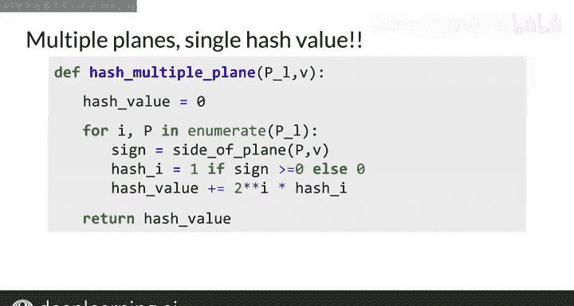

# 吴恩达《自然语言处理｜natural language processing》中英字幕 - P45：44_多平面.zh_en - GPT中英字幕课程资源 - BV1Hc5ezDEWQ

Now that you know how projections work， Ill show you how you can combine several planes to help identify one hash value in other words。

 I will show you how to identify where a data point is given several planes。In the last video。

 you saw how by the sign of the dot product between the normal vector of a plane and a vector representing your data。

 you could get a relative position relative to that plane。In this lecture。

 I'm going to show you how to use this information for multiple planes to get a hash value for your data in your vector space。

In order to divide your vector space into manageable regions， you'll want to use more than one plane。

For each plane， you can find out whether a vector is on the positive or negative side of that plane。

So you'll get multiple signals， one for each plane。

And you want to find a way to combine all of those signals into a single hash value。

This hash value will define a particular region within the vector space。

Let's walk through an example。 Then you will see the general formula for combining signals from multiple planes。

 So for a single vector， let's say that it's thus product with plane 1 is 3。So the sign is positive。

 and the hash value is set to one to indicate that the sign is positive。For the second plane。

The dot product is 5。So the sign is， again， positive。And the hash value is one。For the third plane。

 the dust product is negative tomb。So the sign is negative  one。

 and the hash value is set to 0 to indicate that the vector V is on the negative side of plane 3。

To combine these intermediate hash values into a single hash value， you'll do the following。

 Take two to the power of 0 times H1 plus 2 to the power of1 times H2 plus 2 to the power of two times H3。

 This gives us a combined hash value of 3。 So just as a reminder， you have multiple planes。

 and it helps us to divide the vector space into smaller subres。

 But you want to have a single hash value。So you will know which bucket to assign the vector in。

You do this by combining the signals from all the planes into a single hash value。

Here are the rules you applied written out。If the signine of the do product is greater than or equal to 0。

 assign assign the intermediate hash value of 1。Otherwise， if the dot product is less than 0。

 assign the intermediate hash value of 0。To combine the intermediate hash values， use this formula。

 This is how you get locality sensitive hashing。Let's implement this in code。

Given a list of planes and a vector。Start with a hash value of 0。

 which you'll use to accumulate the sum of intermediate hash values。Then for each plane。

 you want to calculate the sign of the dot product。Set the intermediate hash value to1。

 if the sign is greater than or equal to 0， L set it to 0。

 then you multiply the intermediate hash value by 2。

 raised to the eh power and add it to the hash value。Finally， you return the hash value。

So if you on code in the lecture Notebook， you'll get the same result as the example you saw earlier。

Go ahead and try it out。 Now you have seen what it means for a hash function to be locality sensitive。

 and you have seen examples of such hash functions。 Next。

 you will see how this is useful for the speeding up of the key nearest neighbor computation。

 Let's go to the next video。