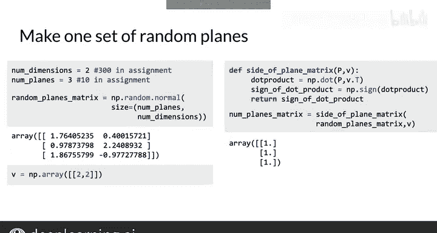

# 吴恩达《自然语言处理｜natural language processing》中英字幕 - P46：45_近似最近邻.zh_en - GPT中英字幕课程资源 - BV1Hc5ezDEWQ

In the last video， you learned about locality sensitive hashing。Now。

 it is time to put all this knowledge to use。 You'll make an algorithm that computes the key neighbors much faster than brute search。

😊，So far， we've seen that a few planes such as these three can divide the vector space into regions。

 but are these planes the best way to divide up the vector space。

 What if instead you divided the vector space like this。 In fact。

 you can't know for sure which sets of planes is the best way to divide up the vector space。

 So why not create multiple sets of random planes。 So that you can divide up the vector space into multiple independent sets of hash tables。

 you can think of it like creating multiple copies of the universe or a multipleverse， if you will。

You can make use of all these different sets of random planes in order to help us find a good set of friendly neighborhood vectors。

 I mean， a set of K nearest neighbors。So back to our multiple sets of random planes over here。

 for instance， let's say you have a vector space and this magenta dot in the middle represents the transformation of an English word into a French word vector。

You are trying to find other French word vectors that may be similar。

 so maybe one universe of random planes helped us to determine that this magenta vector and these green vectors are all assigned to the same hash pocket。

Another entirely different sets of random planes helped us determine that these blue vectors are in the same hash pockets as the red vector。

 A third set of random planes helped us determine that these orange vectors are in the same hash pockets as the magenta vector by using multiple sets of random planes for locality sensitive hashing。

 You have a more robust way of searching the vector space for a set of vectors that are possible candidates to be nearest neighbors。

😊，This is called approximate nearest neighbors because you're not searching the entire vector space。

 but just a subset of it。So it's not the absolute gay nearest neighbors。

 but it's approximately the gay nearest neighbors。You sacrifice some precision in order to gain efficiency in your search。

 so let's see how to make a set of random planes in code。

 assuming that your word vectors have two dimensions， and you want to generate three random planes。

 you will use numpy do random do normal to generate a matrix of three rows and two columns as you see here。

You'll create a vector V。 and for each random plane， see which side of the plane the vector is on。

So you'll find out whether the vector V is on the positive or negative side of each of these three planes。

 notice that instead of using a for loop to work on one plane at a time。

 you can use numpy dot to do this in one step。 Let's call the function。

The result is that vector V is on the positive side of each of the three random planes。

You've already seen how to combine these intermediate hash values into a single hash value。

 but please do check out the lecture notebook to see all the code and to practice this last step。

As you see， locality sensitive hashing allows to compute key nearest neighbors much faster than naive search。

This powerful tool can be used for many tasks related to our vectors。

 and I will show you how it can be applied to search in the next video。

