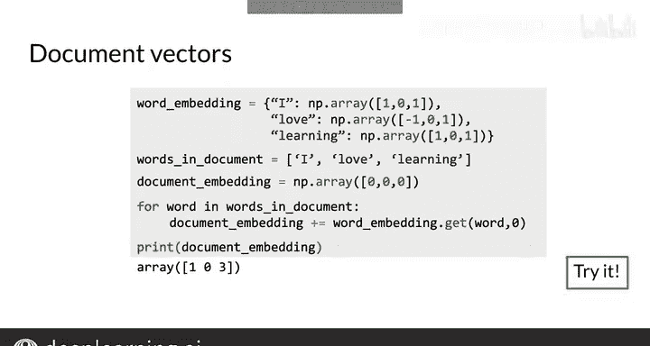

# 吴恩达《自然语言处理｜natural language processing》中英字幕 - P47：46_文档搜索.zh_en - GPT中英字幕课程资源 - BV1Hc5ezDEWQ

I will finish this week by showing you how you can use Fast K nearest neighbor to search for pieces of text related to a query in a large collection of documents。

 you simply create vectors for both and find the nearest neighbors。

To get ready to perform document search， first， think about how to represent documents as vectors instead of just words as vectors。

Let's say you have these documents composed of three words。 I love learning。

How can you represent this entire document as a vector。Well。

 you can find the word vectors for each individual word， I。Love。Learning。Then just add them together。

 So the sum of all these word vectors becomes a document vector with the same dimension as the word vectors。

 in this case， three dimensions。You can then apply documentcu search by using K nearest neighbors。

Let's go this up。Create a mini dictionary for word embeddings。

 Here is the list of wordss contained in the document。

You're going to initialize the document embedding as an array of zeros。 Now。

 for each word in a document， youll get the word vector if the word exists in the dictionary else，0。

Youll add these all up and return the document embedding。Please try it out。

You learned in this video an example of a very general method that text can be embedded into vector spaces so that nearest neighbors refer to text with similar meaning Well。

 youll learn more advanced ways to embed text This basic structure will reappear again and again and again as it's used throughout modern NLP。

