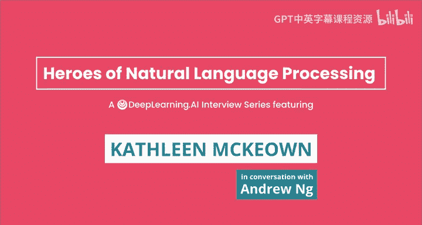
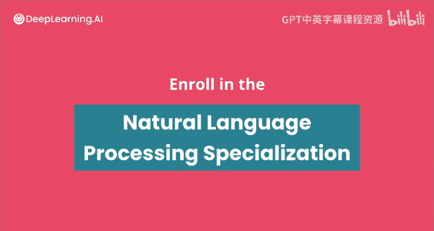

# 吴恩达《自然语言处理｜natural language processing》中英字幕 - P49：48_Andrew Ng与Kathleen McKeown.zh_en - GPT中英字幕课程资源 - BV1Hc5ezDEWQ

H， I'm delighted to have with me here today， Kathy McCn。

 who is the Henry Gertrude Rothschild Proor of computer science at Columbia University。

 where she is also the founding director of the Institute for Data Sciences and Engineering。

 She is also an Amazon Scholar and is well known for the work that she's done over many years on tech summarization and many of the topics in NLP。

 So welcome Kathy， and thanks for joining me。Thanks Andrew and thanks for having me。

So today you lead a large group doing NLP research。

 but your journey to becoming an AI research and an NLP researcher has been an unusual one。

 if I'm re correctlyly， you actually majored in comparative literature when you're an undergrad even though you're also very mathematical you oriented at the time。

 so tell us your story of how you became an NLP researcher。Yeah， so when I started out at Brown。

 I didn't know what I wanted to major in， so I took courses both in math and comparative literature and as I went on I became more interested in comparative literature。

Probably in part because of the teachers who I had who really influenced me。

It was only as I came near the end of my time at Brown and when I graduated。

 I took a job as a programmer which I found actually very boring and I thought if I what was going to have to be working 40 hours a week I wanted to be doing something that I enjoyed and it was then that a friend of mine who was a linguistics major at Brown told me about computational linguistics and so I spent a lot of the year in the library reading about AI and natural language processing and when I applied for graduate school the following year I knew that was what I wanted to do because it gave me a way to bring together my interest in language and the math so that's fascinating so as a comparative literature major you spent a lot of time in the Brown University library reading about computational linguistics。

NLP today with a lot of learners， maybe some watching this video that may not yet be a NLP researcher or AI engineer wanting to break into the field。

 so I'd love to hear more about what your experience was like， you know。

 reading so much were you doing by yourself， Did you have a study group or what was that like？

I was doing it entirely by myself， I really had no guidance in terms of what to look at。

 I guess this friend that I had made a few suggestions and then I traced references you know when I first began reading I would follow up on references to go further yeah。

When I first entered graduate school and you know I had essentially switched fields。

 I found it very frightening， I was sure that you know。

 I was an imposter that I didn't know enough and before long they would find out you know。

 that I really shouldn't be there after all。啊。Yeah， but that's something， you know。

 you overcome with time and you learn that it's not the case and people value your input。Yeah。

That's really inspiring thank you for sharing that。Would you have any advice for someone。

Maybe today that is trying to do this themselves and wondering if they know enough or are good enough or should be in the field。

 It sounds like you。Got through that。 And you've been incredibly successful。

 But what would you to say to someone today， maybe looking to follow on your footsteps and wondering if。

 you know， this is right for them or or they'll make it。So I guess I have a couple pieces of advice。

 I do think reaching out to people and talking to people is useful。

I just was until I got to graduate school， I wasn't in an environment where I had people to talk to。

 so I do think it's really helpful especially to talk to your peers about what they're doing and what they're interested in。

When you pick problems to work on， and I guess especially in today's world of deep learning and neural nets。

 I would。Advise choosing problems that are different from what everybody else works on。

Sort of strike out in a different direction， choose something new。

 a new task and take off from there。嗯。And I think would love to come back the to the different problems talking the bit。

 and when I speak with learners from around the world， I do hear from some that they feel。

Lonely or isolated。 Theyre kind of oh somewhere。 maybe not living， you know， in a major tech hub。

 And they sometimes feel like they're doing this by themselves。

 So I find it actually really inspiring that you were able to do that by yourself in the in a library in Brown university。

嗯。I don't know if you have anything any other thoughts to offer learners that may feel like。

 you know， they're somewhere in a company or in a city just trying to do this by themselves。

I'm not sure I do have a lot more to say about it。I guess， you know， read what you enjoy about。

If you can be part of a reading group an online reading group， that would be helpful。

 there are a lot of reading groups now and that that's a good way to get sort of insights。

There are online videos and course experiences like like yours。

 and I think that's a way to find out what's going on and get in touch with what people are doing so I think。

Today， the online environment can help people get connected and hear what's going on。I was lucky。

 I mean I was really lucky， I applied to Penn， I didn't know that at the time it was the best place in natural language processing。

And that was totally luck， so I don't know that I would recommend you know doing it blind again today。

 I think getting advice is great。Everyone that's been successful has had many elements of luck。

 but the preparation。Makes you ready to take advantage of when good luck falls into your lab。Yeah。

 thank you for sharing that。 That was really inspiring to hear about your early days as a developing researcher。

 And today， you leave a launch group at Columbia University doing very interdisciplinary work and doing a lot of work on summarization and and other topics。

 So tell tell， tell us a bit more about your current work and what you're excited about。😊，So I have。

 I mean， summarization has really been the bulk of my work over the most recent years。

We've done work on summarization of all kinds of different genres from personal novels to emails。

 one thread of research and summarization that I'm particularly excited about is work that I've done with researchers at Amazon and which was published at ACL。

 and this is work on summarization of novel chapters。嗯。it's very new。

 no one has been working on this task， it's very challenging， very de summarization。

 so the chapters are much longer than the news articles on which most current work in summarization today is done and that is a challenge for current neural models。

And。A big problem is that there is an extreme amount of paraphrasing between the input。

 which is 19th century novels。And the output， which is a summary written in today's language。

 none of the current models can handle the kind of paraphrasing that we see there are and that in general is a topic that I'm really interested in is this sort of very abstractive summarization where the sentences are used different words than the input document where the synctic structure is different and that is very different from the vast majority of work today which is done on summarization of news and it's done on summarization of news because that's where the data is so some of the other areas that I'm looking at are summarization of personal narratives that you find online where the personal narratives。

A very informal language and the summary is more formal。

 summarization of debates in past work we've also done summarization of email。

 which has some of those same characteristics。Why did you choose to work on the novel summarization task？

Well， so we had done work on novels even earlier， I would say in 2010 when one of my students。

who was very interested in creative writing and I really thought he should do a PhD and so to convince him to stay。

 you know we came to a topic that he would be happy with which was analysis and generation of creative language and I felt then that my work came full circle that we collaborated then with a professor in comparative literature。

 so I came back to my roots in comparative literature and that was a lot of fun so when I first went to Amazon you know I knew because of Kindle and online on Amazon they have a lot of novels and I thought。

What would be more fun than being able to summarize novels sounds like a fun project I read along on my Kindle so maybe your work will be a future in the Kindle someday。

One aspect of your work that stood out as well is that。

 you know for doing highly interdisciplinary work。 so rather than you know。

 focusing narrowly on NLP research， your work has span AI and the media where I know Columbia University is a great journalism school So wonderful journalists that work with there or the application of NLP to social networks。

 I think your work with medical problems So tell us it about how you think about interdisciplinary work。

 because you've done more of it， I think then。Than most NLP researchers have。

Yeah I really enjoy interdisciplinary work I think it's my most favorite kind of research to do and in part you know we get a really different perspective on research in the world when we talk to people in other fields it takes us out of our sort of technical narrow narrow field and so earlier you alluded to picking research topics that the novel and I think your research portfolio has certainly touched on a lot of problems that very few others are working on so can you say more about that but how do you pick research process to work on and how do you advise others to pick topics to work on。

I think it's important to pick a task that matters so that for me is one thing to look at。

For example， most of the work in tech summarization today is done on summarization of what's called single document summarization of news so take one news article in and generate a summary of that news article and the reason for that is because that's where the data is there's a huge amount of data that has been pulled together from first the CNN Daily mailil corpus and later New York Times and。

There are a number of other corporatera as well。The problem is that's not really a task that we need we've known for a long time that the lead of the news article can help people pretty well in serving as a summary of the document and in fact for years it was hard to beat the lead people just worked on that wasn't a problem that people worked on in the early years of summarization the first sentence of the first couple of sentences in the news article。

Yeah， I mean people work on a problem like that because that's where the data is。

 we have leaderboards， people are competitive， they like to beat the leaderboard。

 but I would question do that one where even half the point in Rouge which is used to the automated network used to score them really make a difference if you look at the output you can see that actually the summaries are quite similar and either one of them might be fine so。

I prefer to go in directions that people haven't gone in before and to choose a task where if you solve it its it's going to help people it's going to be a useful application that you've developed so this is this is why I have done things like。

Summarization of personal narrative， which we did in the course of disaster so that we could summarize。

 think of having a browsing view of summaries of what people have experienced after they've lived through a disaster or the current work on summarization of novels would it be helpful to have a summary of。

An input chapter I'd like to go in a different direction in part because I want to solve the task that matters but I also like to go in a different direction because in this day and age of deep learning where results come so fast everybody works on the same problem trying to beat the previous state of the art it can be hard to be the first one to get there and if you go in a different direction nobody else is working on you are going to be the first one to come to solution and that's what I like to do in my research over time I like to be first on a problem and I feel like I have for myself I have a lot of respect for people that can push that extra half points of performance on the leaderboard because hopefully that advances the whole field and this all shifts I also have a lot of respect for people with the yard。

In the insight to charter the new problem that no one else has thought of and advances a whole field in a different direction I think you know the field of AI and LP is broad up I think is actually not a bad thing if we have lots of people who working on lots of different things。

 including the standardized benchmarks and a bunch of new things Yeah sure I I just。

I feel that there are not as many people who want to go in that new direction and it does it does take some。

you know， sort of guts to do it because the first thing that happens when you submit a paper is there's no。

 you know， there is no benchmark， there is no baseline of prior work and reviewers have a very hard time dealing with that。

 you know， how can they judge whether it's， you know a really a good step forward， whereas you know。

 if you can show on a leaderboard that you can prove by a certain amount and you stay within the traditional trajectory。

 it's easier to judge。Yeah I'll go you on that actually as you chatting with one of my friends Sharon Jo who mentioned that sometimes the way benchmarks and metrics are established is that some research are publishing a paper publishes something using some metric。

 maybe a good one， maybe an okay one， but to make sure that subsequent papers can compared to earlier work than everyone and more and more people end up using the same metric more for historical reasons that it makes thingss comparable rather than because it is actually the most useful metric is funny how metrics is still established in academia Yeah I mean that has happened in the conversation field then。

I think also in machine translation where you want an automated metric because it's easier to develop a system to train over and over again and yet everybody knows that the automated metrics that we currently have a really flawed and but everyone keeps using them because that's what we've always done you know one of my most stock memories was I remember going to a CIR。

 the information reval conference and attending workshop and text sumization and I remember being struck a fascinated that struck that about half of that workshop was on text summarization algorithms and the other half of that workshop was on how to develop metrics to evaluate the other half of where I think text sumization especially the development of automated metrics has been challenging yeah。

Cool so in terms of choosing new topics to work on， one of the pieces of work that you've been doing。

 the life bulb was fascinating was you were taking texts from the black community from Harlem near I guess where you teach at Columbia University and analyzing that as well。

 tell us a bit about that。This is where I'm moving with my work with the researcher from social work and we're also beginning to involve a linguist who works on African American vernacular and what we're doing is we're looking at。

呃。What people say， what kind of emotions they express in reaction to major events that are going on today。

 so for example， in reaction to Black Lives Matter and in reaction to COVID-19 so this is work that we're just beginning we've begun with developing and interface where people can post about their experiences with these events and you know how they're feeling。

And I guess what we're hoping to do with that。In part， so we have two directions to go。

 one on the natural language side is to be able to understand how people express different kinds of language sorry。

 different kinds of emotion and African- American vernacular and how that difference from how people express it in standard American English and you know look at the difference in language。

Probably even the difference in content in terms of what's expressed and this can help us in developing algorithms that。

You know， are not biased。As we move forward， most of the work in natural language。

 all of the systems have been trained on news that comes。

Language that comes from news like the Wall Street Journal。Yeah， that's great。

 And if this type work can。hellp fight bias or build bridges between communities or just play some role in understanding and and hoping to advance the Black Lives Matt movement that that seems like a wonderful thing to be Yeah yeah I mean we also want in that in that work to look at the impact of trauma so it's a different kind of trauma and sometimes it's not your personal trauma but the trauma seeing what has happened to other people who are like you so yeah we want to look at how that is expressed and the different kinds of emotions。

 the intensity of emotion and so forth。And I find it really wonderful that NLP researchers。

 AI researchers can play an active role in some of these most important societal questions and issues of all time it feels like the work we do as AI researchers it could matter on these really important topics Yeah I mean I think so and I've sort of been trying to do that for a while。

 I think it really attracts students to work with you and often different kinds of students into the field to work with you on our first work on with analyzing social media posts of gang involvedve youth we didn't have funding we did that entirely with undergraduates who were just totally amazing in earlier work we were looking at being able to automatically generate updates about disaster as it unfolded we did that after Hurricane Sanding hit New York。

And again， it was something that students came to me and they had seen this happen and they have seen。

 you know their neighborhoods hurt or they live through the uncertainty of it and they wanted to help。

 they wanted to know what can we do and that was at that point in time。

 this was preneural net we began developing systems that could automatically generate updates as an event unfolded now it is actually great to think that you know。

 you don't need a PhD， don't need a long publication record。

 but then undergrad spotting an opportunity with a desire to help can step in and start to work on systems that they could make a difference Yes。

 they're really passionate about it and theyre really good very you know。

 the work that came out of that was was really，Excellent。Yeah， thank you。

So Chelsea this is great stuff。 and searching tracks a bit。 You've been working in， you know。

 NLP and and associated areas for a long time。 In fact， I saw that even way way back in 1985。

 you written an early book on text generation。 before the modern neurotext generation techniques were around。

 So you've been a leader in the field for a long time and seen a lot of things change。

 I'd love to hear your thoughts on how the field of N LP has has evolved over these many years。😊。

Sure， so when I started， which I got my PhD in '82。

 so I spent those early years at Penn and there were some characteristics of the field that were you know。

 salient or。So one of them is that there was a lot of the interdisciplinary work。

 there was in developing NLP systems， we drew a lot on work from linguistics。

 from philosophy from psychology from cognitive science and so when I was at Penn I interacted a lot with。

Faculty from linguistics， Ellen Prince was one of the people or faculty from philosophy。

 we spent time you know in these interdisciplinary meetings and you know I can remember walking across campus with my advisor to go from the computer science department to the psychology department for example。

嗯。I was influenced a lot and I have to I have to mention this。

 although it's not exactly what you asked， I was influenced a lot by senior women at the time if I look back to who was most influential in。

You know how I progressed in my early research， my advisor， of course， who was a male。

 Arab and Joshi， but then also Bonnie Weber who was there in computer science。

 Evaha Chava from Charles University at Prague， who was a linguist， Barbara Gross， who was。

Stanford at that time in the CSLI Institute and Karen Sp Jones was very influential to me。

 she was from the field of the information retrieval and she and I spent a lot of time talking about summarization。

So interdisciplinary is one main feature of that time a second was drawing on theories from these other areas。

 so we drew on theories from linguistics one。Main kind of theory that we looked at was a focus of attention and how that changed over the course of the discourse and how that influenced how you made choices and how you realized text in language so for example。

 did you use a pronoun or did you use a full noun phrase。

 what kind of syntactic structures did you use you might use different syntactic structures to make concept more prominent in the discourse we also drew one work from philosophy so we drew on work from theories from CL about intention and work from Grce about conversational implicature and so we looked at these theories and we looked at how we could embody them in our natural language approaches。

It's great to hear about some of your early sources of inspiration。

 much as I think today you will be a source of inspiration to many others。

So you you've seen a lot and see a lot in NLP， which continues to be a rapidly evolving field。

 so I'm actually curious Kathy， what do you find most exciting in terms of emerging or exciting NLP technologies？

For me， personally， some of the work that I've already talked about today on truly abstractive summarization that uses extreme paraphrasing。

Work on analyzing。The language from diverse communities。

 so we've been looking at the black community， but I think you know there are other communities we could look at as well。

I'm interested in things looking at how you deal with bias and data。

Another very important topic I think is being able to arrive at what I would call paralinguistic meaning。

 so pragmatic information about emotion about intention would be another important direction to go and I also think more work on events being able to。

Understand what events have happened and to be able to follow them。

I also think about often if I look back。Is it okay if I talk about this now if I look back？

If I look back on my favorite technologies and papers。

 I can think of papers from three points in time， the first would be older and this was very early work in language generation on how we picked the words in our sentence and we saw then that it was a hard problem that constraintss came from many different sources and we looked at we wrote a paper called floatinglo Const on Lexical Cho which where we looked at。

How information from different parts of language from the discourse from the lexicon from syntax from semantics would influence what we chose and we worked in two different domains one was basketball and one was stock markets and I give the example of the floating constraint where we have want to express both the time at which something happened and the manner in the first example we express time in the verb and manner and the adverb so Wall Street indexes opened strongly opened is the time and in the second we express manner and the verb and time in the prepositional phrase。

 so stock indexes surged at the start of the trading day and so we wanted to look at how we could control that choice and I think control is something that's missing in language generation。

And summarization today using deep learning methods。

 how do we control control what the output is and make sure it's true to what our intention is。

In more more recent work， my favorite is work on New blaster， which was。

That's still about 15 years ago but it feels recent to me and that was where we took a real world problem we did do some collaboration with journalists and we developed a testbed where we could identify the events that happened during the day and produce a summary on each event and then we also looked at how we could track that over time and this this platform gave us a common sort of application in which my students could address really hard research questions and so that was where we looked at did some of our first work on abstracted summarization looking at how we might compress sentences。

 how we could fuse phrases together how we might reference。😊。

Edit references so that the summary was more coherent and we also did work on multilingual summarization Yeah cool so thank you lots of exciting。

Very distinct projects over the years。Do you have any， let's make a wrap up。 Do。

 do you have any long thoughts， I can just say， do you have any final thoughts。Oh。Well。

 I guess I would just say that natural language is a really exciting field today。

 there's been a huge amount of progress with deep learning。

 we've seen dramatic increases in accuracy， but we still have a lot of directions to go and I guess I would like to see you know more of the interdisciplinary work being brought back in。

 I'd like to see people looking at the data more and at their output more rather than just numbers。

But I think there are many exciting directions for people to work in and I hope we'll see many people join the field。

Thank you That was great and I certainly hope that we'll have a lot more people join NLP and contribute to all of this exciting work so thanks thanks Kas and well thanks so much for asking me it was fun。

😊，For more interviews with NLP Though leaders， check out the Deeplearning。

AI YouTube channel or enroll in the NLP specialization on Coursera。

