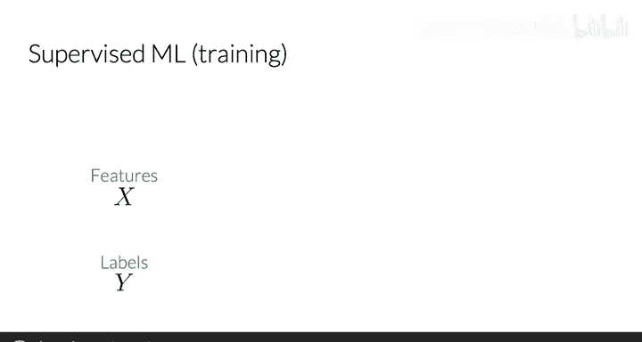
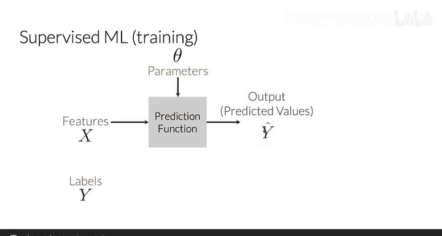
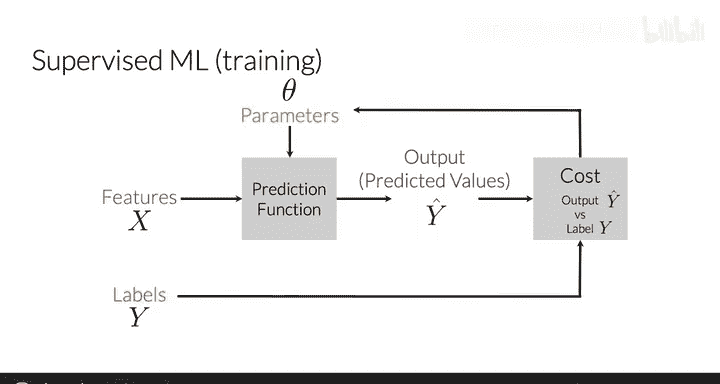
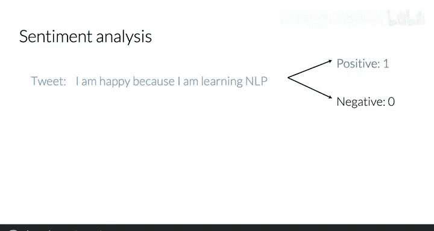
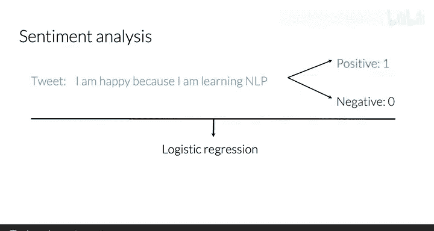
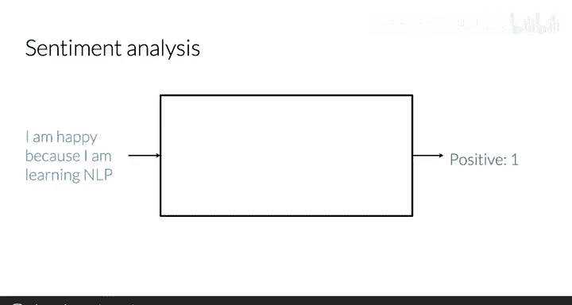
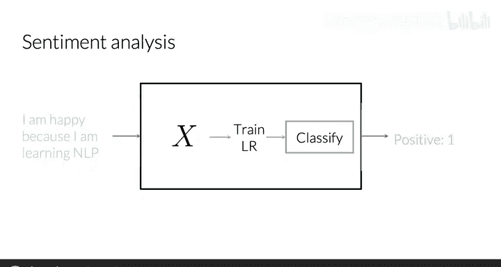

# 吴恩达《自然语言处理｜natural language processing》中英字幕 - P4：3_监督机器学习情感分析.zh_en - GPT中英字幕课程资源 - BV1Hc5ezDEWQ

Welcome and this week you're going to learn about supervised machine learning and specifically you're going to learn about logistic regression in order for you to implement logistic regression。

 you need to take a few steps in this video you will learn about the steps required in order to implement this algorithm so let's take a look。

In supervised machine learning， you have input features X and a set of labels Y。Now。

 to make sure you're getting the most accurate predictions based on your data。

 your goal is to minimize your error rate or cost as much as possible。

And to do this， you're going to run your prediction function。

 which takes in parameters data to map your features to output labels Y hat。Now。

 the best mapping from features to labels is achieved when the difference between the expected values。

 y。And the predicted values， Y hat。

Is minimized。Which the cost function does by comparing how closely your output。

 Y hat is to your label， Y。Then you can update your parameters and repeat the whole process until your cost is minimized。

 So let's take a look at the supervised machine learning classification task of sentiment analysis。

In this example， you have the tweet， let's say I'm happy because I'm learning NLP。😊。

And the objective in this task is to predict whether a tweet has a positive or a negative sentiment。

And you'll do this by starting with a training set where tweets with a positive sentiment have a label of one。

And it tweets with a negative sentiment， heavy label of 0。

For this task， you will be using your logistic regression classifier。

 which assigns its observations to two distinct classes。Next up， I'll show you how to do this。

So to get started， building a logistic regression classifier that's capable of predicting sentiments of an arbitrary tweet。

 you will first process the raw tweets in your training set and extract useful features。

Then you will train your logistic regression classifier while minimizing the cost。And finally。

 you'll be able to make your predictions。

So in this video， you learned about the steps required for you to classify a tweet given a tweet。

 you should classify it to either be positive or negative in order for you to do so。

 you first have to extract the features Then you have to train your model and then you have to classify the tweet based off your trained model in the next video you're going to learn how to extract these features so let's take a look at how you can do that。

