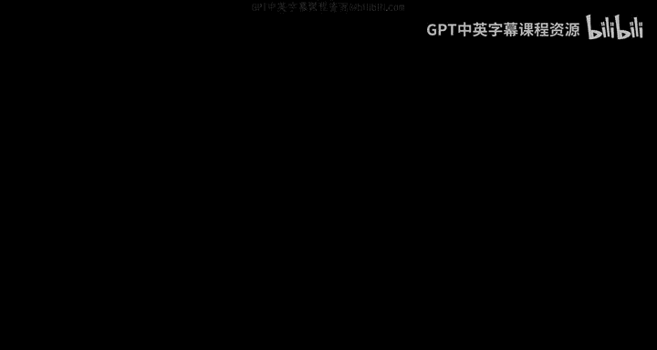
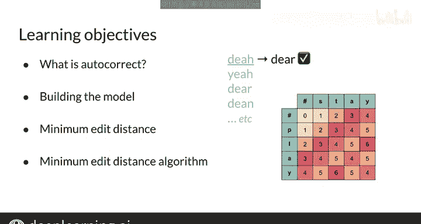

# 吴恩达《自然语言处理｜natural language processing》中英字幕 - P52：2_概述.zh_en - GPT中英字幕课程资源 - BV1Hc5ezDEWQ

Welcome， this week I will go over auto correct。 It is how your misspelled words are corrected automatically to the right ones。

You know it's already from your email clients on your phone。 Let me show you how it works。

So let's go over this week's learning objectives。 You will learn about autocorect conceptually。

 You've most likely used it in your phone or word processor。But what is auto correct， Exactly。

 It can mean slightly different things， depending on the context。

 you'll learn about the nuances this week。You will practice building a model to perform autocorrect。

 You will learn each step in autocor and key concepts to prepare you for decoding assignments。

When performing autocor， you will want to be able to quantify how far apart or different two strings are and ask how many letters you can change to go from one string to another To do this。

 you will learn to measure minimum edit distance。 You will implement a really interesting algorithmic approach for solving the minimum edit distance called dynamic programming。

At the end of the lecture， you will demonstrate your new skills and put all these techniques to work in this week's assignment。

Exciting content。 I'm looking forward to tell you everything about how you will be building your auto correct。

 One very important concept is that the autocor you will be building uses dynamic programming。

 This comes up again and again in technical interviews。 But first。

 let's get started with an overview of auto correct in the next video。😊。

