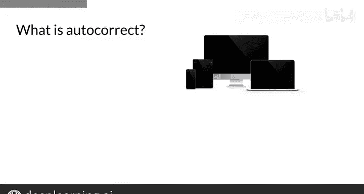
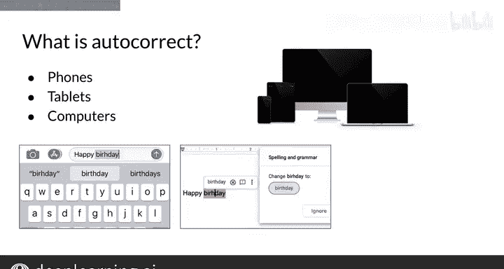
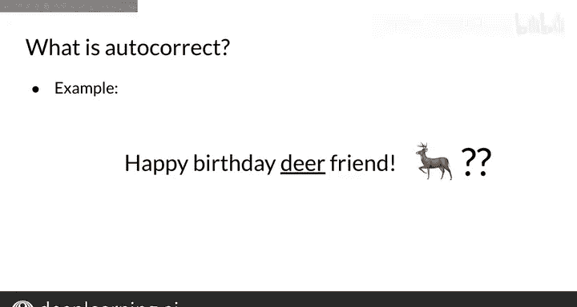
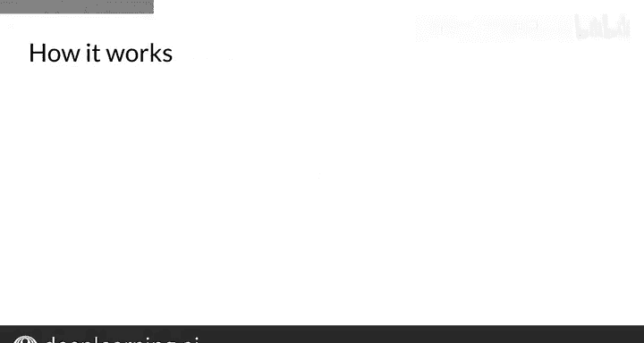
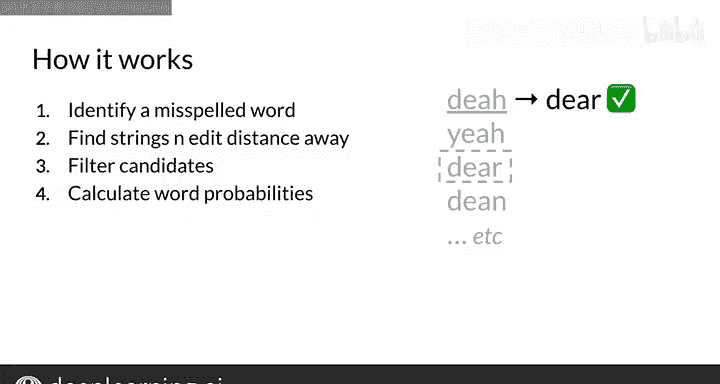

# 吴恩达《自然语言处理｜natural language processing》中英字幕 - P53：3_自动纠错.zh_en - GPT中英字幕课程资源 - BV1Hc5ezDEWQ

I will give you a brief overview of auto correct and how it works。

 You will learn to identify misspelld words， what is an edited distance and how to calculate probabilities of the correct word。

 So let's get started with a simple definition。😊，So what is auto correct。

 auto correctrect is an application that changes misspelled words into the correct ones。

 You probably know it very well already。 you have it on your phone。

 tablet and on your computer inside your document editors and email applications。

For example， it takes a sentence like this one。 H birthday。

 the friend and corrects the misspelled word。 the to a word that you probably intended to write。😊。

Which in this context would be， dear。Correctly spelled D， E， A R。

But what if you typed deer instead of deer here， you see the word is spelled correctly。

But its context is incorrect。Well， unless your friend happens to be an actual de。

 you will not test for this kind of contextual error this week， as it's a more sophisticated problem。

 youll get to learn about that another time。 Instead， this week。

 you will only look forward words that have been misspelled and make corrections to these。

 This involves a simple as powerful model as you will see。

Let me show you an overview of how autocorrect works。 There are four key steps。

First， identify an incorrect word。 Misspelling is one way to do this。Second， find strings 1，2，3。

 or any n at distances away。 Don't worry， you will learn about minimum at distance shortly。For now。

 what's important to know is that if a string is one added distance away from the string that you typed。

 it's more similar to your string compared to a string that is two edit distances away。 Third。

 filter these strings for real words that are spelled correctly。 and fourth。

 calculate word probabilities which tell you how likely each word is to appear in this context and choose the most likely candidate to be the replacement。

So now you have a better intuition for what is auto correctr and how it works。 That's good。 Next。

 you will take a closer look at the details for implementing each step so that you can begin to build the autocorrect model。

😊。

Now you know how autocorrect works in the decoding exercise of this week。

 you will implement it and see for yourself that it works really well。 Next。

 I'll show you how to speed up at a distance computation。😊。

