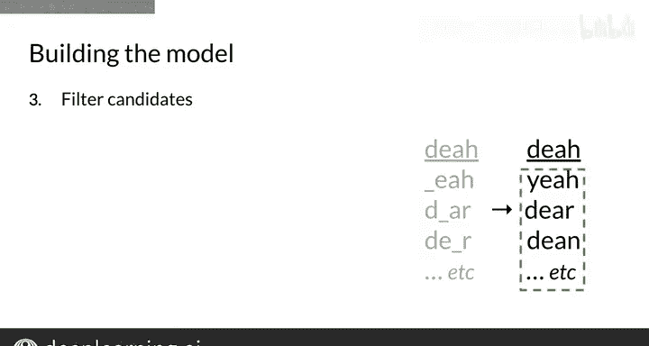

# 吴恩达《自然语言处理｜natural language processing》中英字幕 - P54：4_构建模型.zh_en - GPT中英字幕课程资源 - BV1Hc5ezDEWQ

In the previous video， I briefly mentioned the four steps required to implement auto correct。 Now。

 you're going to take a deep dive into these steps。

You already know the four steps inside the autocorrect model。

 So it's time to look at each step in detail。 You will be implementing each of these steps in this week's assignments。

Step 1， identify a misspelled word。 When the string there is encountered。

 How do you know it's a misspelled word。Well， if it's spelled correctly。

 you'll find this in a dictionary。 If not， then it's probably a misspelled word。

If a word is not given in a dictionary， flag it for correction。

Recall that you are not searching for contextual errors， Just spelling errors。

 There are much more sophisticated techniques for identifying words that are probably incorrect by looking at the words surrounding them。

Some of which you will visit later in the course。 But for now。

 quickly identifying a word as incorrect by its apparent misspelling is a simple is powerful model that works well。

 So words like dear， well pass through this filter just fine as it is spelled correctly。

Regardless of how the context may seem。Step 2， find strings that are 1，2，3。

 or any number and edit distance away when saying an edit distance。

 I am referring to an edit distance of n， such as at distance of1， added distance of 2 and so on。

An edit is a type of operation performed on this string to change it into another string。

 and edit distance counts the number of these operations so that the uned distance tells you how many operations away one string is from another。

Now， consider an insert operation， for example， this is a type of edit that adds a letter to a string in any position。

 For example， starting with the word 2 insert a P at the end and you get top or insert W in the middle and you get2 a delete operation removes the letter。

For example， start with the word hat， delete T from the end。

 and you get ha or delete A from the front， and you get at or delete A from the middle。

 and you get the string H T， A switch edit swaps to adjacent letterss。 For example， the string E T A。

 switch T and A， and you get E or switch E and T and get T。

Notice that you are switching two letters that are next to each other。

 so this does not include switching two letters that are not next to each other。

 such as switching the E and the A to make8 A replace added changes one letter to another。

For example， the word John， change W to R and you get jar or change J to P and you get Paul。

 So using the four edits， insert， delete， switch， and replace， you can modify any string。

And by combining these edits， you can find a list of all possible strings that are n edits away for auto correctrect。

 n is usually one to three edits you will implement each of these edits in this week's programming exercise and combine edits to get a list of two edit distances from the original input string。

Now， step 3， filter candidates。Notice how many of the strings that are generated do not look like actual words。

To filter these strings and keep ones that are real words。

 you only want to consider real and correctly spelled words from your candidate list。 So again。

 compare it to a known dictionary or vocabulary。 Just like can step1。 This time。

 if the string does not appear in the dictionary， remove it from the list of candidates。

 When you're left with a list of actual words only then that is good progress。

 That's the first three steps of building the autocorrect model in the next lesson。

 youll see the fourth and final step。

You learn about three of the four steps required to implement autocorects for the first week。

The first step was identifying the misspelled word。

 then finding the strings that are uneded distances away。

 then filtering the candidates that are actual words。

Now the last step is calculating the probabilities， which you will learn about in the next video。

