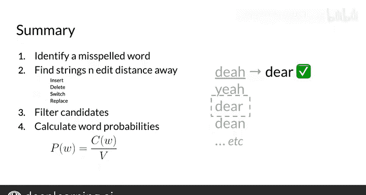

# 吴恩达《自然语言处理｜natural language processing》中英字幕 - P55：5_构建模型II.zh_en - GPT中英字幕课程资源 - BV1Hc5ezDEWQ

Good to see you again As promised in the previous video。

 I will now show you how to calculate the probabilities of each possible correct word。

Now that you have a list of actual words， you can move on to step 4， calculate word probabilities。

The final step is to calculate word probabilities and find the most likely word from the candidates。

 For example， the word and is more common than the word and in any given body of text。

 also called a corpus。 This is how autocorrect knows which word to substitute for the incorrect one。

To understand this better， look at this example sentence。

I am happy because I am learning to calculate the probability of a word in the sentence。

 you need to first calculate the word frequencies。😊，In addition。

 you want to count the total number of words in the body of text or corpus。Normally。

 a corpus would be much larger。Imagine every issue of a certain magazine ever published or all of the Harry Potter books to keep this example as simple as possible。

 The corpus here is defined as this one sentence。For example， the word I appears twice。

The word M appears twice also。And so on for the rest of the words。

The total number of words in the corpus is 7。The probability of any word within the corpus is the number of times the word appears divided by the total number of words。

For example， the word M appears twice， and the size of the corpus is 7 for auto correct。

 you find the word candidate to the highest probability。And choose that word as the replacement。

And that's it。In summary， to implement autocorr you did the following。You entered a word to correct。

 for example， the misspelled word B D E A H。 Then you follow the four steps inside the autocorect model to get its replacement。

You identified death as being misspelled by checking it against known words。

Then you made the list of all the strings that are n edits away。

You filtered this list of strings to include only the ones that are actual words in a given dictionary。

And then you calculate the word probabilities for each of these words。

You selected the word with the highest probability as the autocor replacement。And that was it。

That's a lot to cover。 But breaking it down step by step gives you a good intuition for how to implement auto correctr。

 This is something that will come in very handy for the assignment。 So well done。Also。

 you now understand edit and edit distance and how they can be used to measure similarity between words。

 Next， get ready to apply these concepts to building a metric very common in NLP for measuring similarity between words。

 strings and many more。

You have seen the four steps required to implement autocorrrect for this week's programming assignment This is exciting Now in the next video we will look at how we can evaluate similarity between two strings。

 for example， a word with a typo and a word without。😊。

