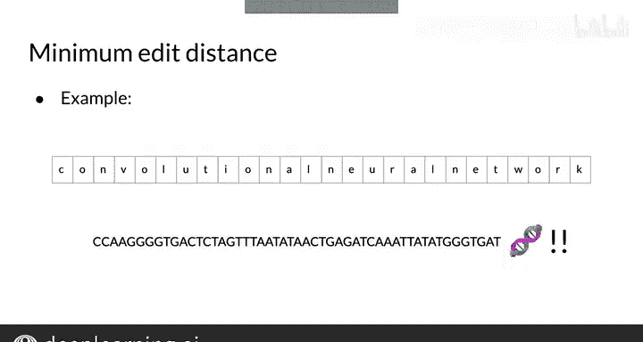

# 吴恩达《自然语言处理｜natural language processing》中英字幕 - P56：6_最小编辑距离.zh_en - GPT中英字幕课程资源 - BV1Hc5ezDEWQ

Minimum at distance has a wide variety of applications。

 it allows you to implement spelling correction， document similarity， machine translation。

 DNA sequencing， and more。I will also show you the different types of edits。

You have already seen how to build also correct using edit distance。

 but consider a slightly different problem。What if you are given two words。

 strings or even whole documents， And you wanted to evaluate how similar they are。

 Minimum added distance can be used to do this。 Given two strings。

 the minimum added distance is the lowest number of operations needed to transform one string into the other。

It has many applications in an LP， for example， it could be used in spelling correction。

 document similarity and machine translation。It can also be found in computational biology and DNA sequencing。

For calculating minimum edit distance， you will use three types of edit operations。

 All three operations that you already know insert。Delete。And replace。For example。

 to turn play and to stay。 what is the minimum number of edits required to make this happen。

So to turn P into S， you replace P within an S and to turn L into T， you replace L with a T。

Both a and a are the same。 so do nothing。And it's the same with why and why。

So the total number of edits is2。Until this point， you've considered all edit operations to cost the same。

 That is a cost of one。 But now you will consider a different cost for each type of operation。

You will use these costs to calculate the edit distance， which now represents the total edit costs。

This is what you are trying to minimize。 It is simply the sum of costs for the edits that were made。

Insert and delete will have a cost of one， and replace has a cost of two。

 This makes intuitive sense if you think of replacement as a delete， followed by an insert。

Calculate for this example， you have two replace edits at a cost of two each。

For a total added distance of 4， this is a relatively simple example。

 and it was possible to find the minimum added distance just by looking at it。

But imagine the number of operations between much longer strings。And large corporal of texts。

Or even DNA strings。You can try and solve these problems by brute force。

 adding one added distance at a time and enumerating for all possibilities until one string changes to the other。

But this could take a very， very long time。In fact， by solving this way。

 the computational complexity increases exponentially as each string grows in length。

A much faster way is by using a tabular approach。 you'll implement this next。

The tabular approach I spoke about allows you to speed up the enumeration of all possible strings and edits。

 In doing so， you will also be learning about a new concept known as dynamic programming。😊。

We'll see about this in the next video。