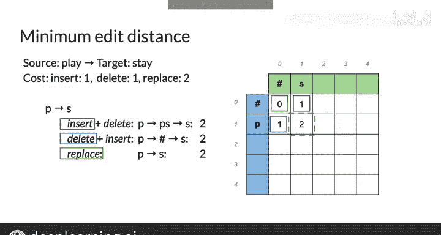

# 吴恩达《自然语言处理｜natural language processing》中英字幕 - P57：7_最小编辑距离算法.zh_en - GPT中英字幕课程资源 - BV1Hc5ezDEWQ

Welcome in this video I will teach you about dynamic programming。 we will go through one example。

 but once you understand that you'll be able to apply dynamic programming to anything。

So you start by laying out the problem like this where you have the source word play here down the left column。

 and then the target were to transform into stay along the top row here。

And an empty string placeholder presented by the hashtag symbol at the starts of each string here。

 The reason for this will make more sense in the steps ahead。

There are also some row and column indices here， just to make things a bit easier to follow along。

Now， the goal is to fill out this distance matrix D， such that the element D2，3， for example。

 refers to the minimum added distance from PL to ST TA。

Which is the first two letters of the word play to the first three letters of the target word， stay。

 or more generally for any element in the matrix by using this formula for the element Atro I and column J being I equals 2 and J equals 3 in the example P to ST TA。

From the previous few slides， you know each D of IJ will be the minimum at a distance between the beginning of the source word to index I and the beginning of the target word to index J。

So that for a source of length M and a target of length N， when you get to the bottom right corner。

 D of M N， you have the minimum added distance between the two strings。

 You will compute this from the shortest substr to the full string。

 That is starting with the shortest string in the top left corner and working down then to the right。

 The intuition is that you can build upon each subproble by combining solutions。 For example。

 finding the minimum added distance between two letters is easy。

Then you increase the problem size one letter at a time， building on what you already know。

 If this seems confusing at first， don't worry， it is。

But it will start to make more sense as you work through the example。But first。

 before you get started， recall the cost for each edit。

 one for insert and delete and two for replace。Okay。

So the first step is to transform the source empty string into the target empty string。

The added distance between the source empty string and the target empty string is 0。

 There is no formula here。 It's just a special case。So far， so good。Okay。

 to change nothing to nothing， you do nothing good。Then you can move on to p to empty string。

And you can do this with a delete edit its operation at a cost of one。Then， empty strength to S。

Which you can do with an insert at its operation at a cost of one。Now， look at P to S。

 There is more than one possible way to make this transformation。

 Each possible sequence of edits is known as a path。Starting with P。

 you can insert S on the end to get P S。 then delete P from the beginning to get S。

 This has a cost of one insert and one delete。 at this point。

 notice that you've already calculated the cost of inserting a letter S。

It's found in this red box here on top when you calculate how to get from empty string to S。

So you actually just calculate the cost of deleting the P and add it onto the cost that you've stored in the red box above。

 this is 1 plus1 equals 2。In the second possible path， starting with P。

 you can delete P to get hashtag。And then insert S to get S。

Notice again that you've already calculated the cost of theleting P in this blue box in the left。

The blue box is the cost of going from P to hashtag by deleting P。

 so you can calculate the cost of inserting P and add it to the cost that you've stored in the blue box on the left。

 This is 1 plus 1 equals 2。The third way is to replace P with S so that you go from P to S in one step at the cost of2 for replacement Vily。

 you can think of going from this green box and jumping directly into the orange box。

The green box is the cost of not doing any edit， which is 0。 A replacement has a cost of 2。

 So 0 plus 2 equals 2。Then you take the minimum of all three of these paths。

 which is a2 in this case， then place that value in the cell which gives you the minimum at the distance from P to S。

So working off what you've already filled out， you'll notice that to fill in a cell。

 you need to know the cell above to the left and adjacent upper left shown in red。

 blue and green here in doing so， you can benefit from some calculations already performed。 So。

 I'll show you how to generalize this in a formula to fill out the rest of the matrix。But first。

 I will show you how to fill out the first column and the first row so that every cell remaining has its own red。

 blue and green cells available as dependencies。 This is what's coming up next。

In this video you will learn about the cost of each operation， insert and deleting is one。

 and then replacing this twomb。 you also saw how you can populate your table In the next video。

 you will learn about a much faster way to populate your table。

