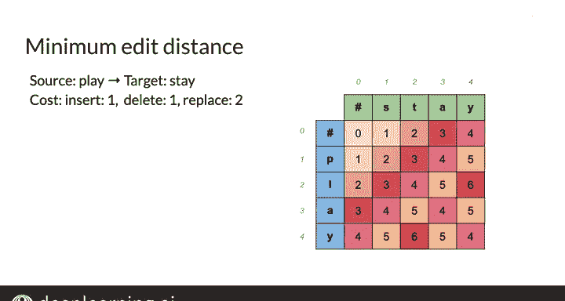

# 吴恩达《自然语言处理｜natural language processing》中英字幕 - P58：8_最小编辑距离算法II.zh_en - GPT中英字幕课程资源 - BV1Hc5ezDEWQ

In this video， we are going to translate how to populate the table mentioned previously used to change from one word into another with some code。

By the end of the video， you'll see the finished products。Earlier。

 you used an intuitive approach to fill out the upper left corner of the minimum added distance table。

Now， I'll show you how to use a formulaic approach to fill out the rest。

So you filled out some of the table already， and it looks like this。Now。

 to fill out the rest of the table， you must first fill out the remaining cells of the lefts most column and top row。

In fact， you know that to transform play into an empty string， you can just delete each letter。

So let's try that you can fill out these cells top to bottom by following this formula。For each cell。

 look at the cell above and add the cost of an extra delete edit， which will be one。

This means that to make the strength P。Into the empty string， do want the lead operation。

As shown in the previous example to turn the string PL into the empty string， deletes P and delete L。

 which are to delete operations and so on。Now， at D 4，0。

 you have the minimum added distance for play to the empty string， which， of course。

 is just the cost of four deletes 4。You can use the same ID in the first row by transforming the empty string to stay by inserting one letter at a time。

You do that by following this slightly different formula， working from the left to the right。

 Look at the previous cell and add a further insert cost 1。Looks good so far。In the previous example。

 I showed you how to calculate this cell without formulas。

 but you can also find the solution by applying this big scary looking formula。

 It builds upon the computations you've already made in just the same way as using the no formula method。

Some of this might feel like it's repeating what you just learned。

 but it's valuable to see the formulas， too， especially when getting ready for the end of week assignment。

 So the distance to this orange cell is going to be the minimum distance to reach it from any of the previous three cells。

Interesting， right？ It might seem a little bit abstract at first。

 but you can break it down into smaller parts。For example， if you come from the cell above。

 you will add delete cost， just like you did in the first column。

 if you come from the cell to the left， you will add an insert cost。

 just like you did in the top row。 And if you come from the cell to the upper left。

 you will do one of two things， either add the replace cost if the two letter source I and targets J don't match。

Or add nothing， if they do。Because there is no edit to be done for letters that are already the same。

 So here for this cell， you have the minimum of one plus one， which is 2。Another one plus one。

 which is 2。Says these two letters don't match。 you have 0 plus 2， which is also tomb。

Then you take the minimum of all three of these， which is a2 in this case。

 place that value in the cell。 This is the minimum added distance from P to S by using the formula and costs defined。

You can then fill out the rest of the table the same way。

With the M N entry in the bottom right corner being the minimum added distance from play to stay。

 which is4。Adding color coding or a heat map reveals some interesting patterns。

Can you see what's happened from the middle square。That's right。 Once you get from P， L to S T。

 the suffix of both words is the same。 A Y。 So there are no more edits needed。

 And that's why this4 carries down the diagonal。Now you know how to build a minimum added distance algorithm efficiently using a table。

 well done。There are a few things worth noting about this style of implementation before you go。

 I'll show you those next。

Congratulations， now you have seen some code that you will be using in the programming assignments In the next video。

 I will show you some more tricks that will help you with the programming assignments。 See you soon。

😊。