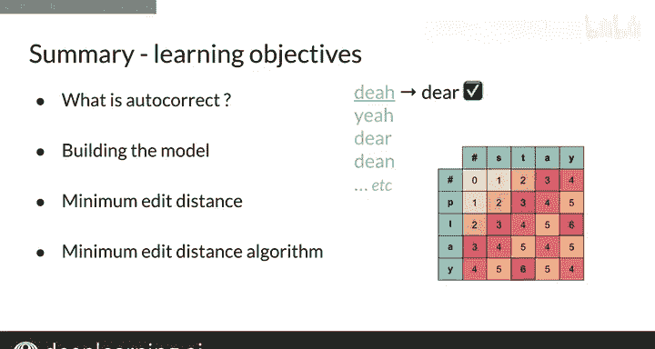

# 吴恩达《自然语言处理｜natural language processing》中英字幕 - P59：9_最小编辑距离算法III.zh_en - GPT中英字幕课程资源 - BV1Hc5ezDEWQ

This video gives you a complete overview of minimum edit distance and shows you what to do if you want to reconstruct the path you took when doing the edits。

 Let's dive in。A few quick notes on the minimum edit distance implementation you learned。

 measuringuring the edit distance by using the three edits insert delete and replace with costs 1，1。

 and2， respectively is known as Linstein distanceance。That's what you've used here。

 You can look it up for more details。 if you like。 There are also well known alternatives that have different edit rules。

 Find the minimum added distance on its own doesn't always solve the whole problem。

 You sometimes need to know how you got there。 too。 You do this by keeping a back trace。

 which is simply a pointer in each cell。 letting， you know where you came from to get there。 So。

 you know， the path taken across the table from the top left corner to the bottom right corner。

This tells you the edits taken and is particularly useful in problems dealing with string alignment。

 But that's a discussion for another time。Finally， the tabular method for computation instead of brute force is a technique known as dynamic programming。

 Intuly， this just means that solving the smallest sub problemble first and then reusing that result to solve the next biggest sub problem。

 saving that result， reusing it again and so on。This is what you did here by solving each cell in order。

 It's a well known technique in computer science and will appear again and again in the coming weeks of this course。

And that's it。This was a long lesson。 So well done。 You should be proud of yourself。

 You took the problem of solving minimum added distance and broke it down into two parts。

 Then use a tabular based approach step by step for a very efficient implementation。 Great work。😊。

Now try the programming assignment where you will code up this example with an optional challenge to build a back trace tool。

What a journey。 And you're just getting started here。

 The weeks ahead are loaded with more exciting stuff。 But before you go。

 a quick recap in the past few lessons， you learned a lot about some real world applications of N LP that you're probably using every day。

 You learned about autocorrect and what it is and how it works。 It magic。

 You went step by step through how to build a working autocorr model using edit distance and word probabilities。

😊，You learn about the problem of string， similarity and metric of minimum at a distance。And finally。

 you learned a really cool way to solve minimum added distance using a tabular algorithmic technique known as dynamic programming。

You now have to know how to practice all these new skills in the Week1 programming assignment。

 have fun and good luck。

Congratulations on finishing the week minimumum added distance introduces your first application of dynamic programming。

In the next week， you will learn about the Vicherbi algorithm。

 which also makes use of dynamic programming。 See you soon。😊。

