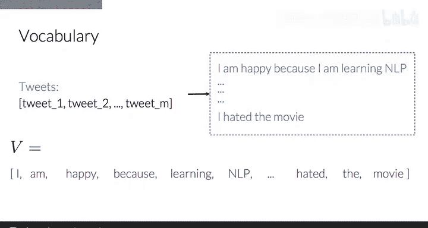
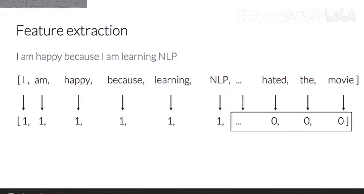
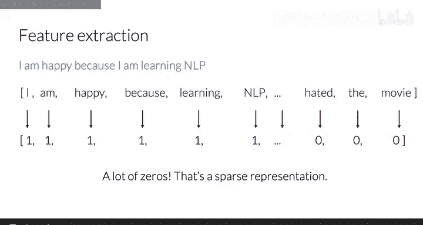
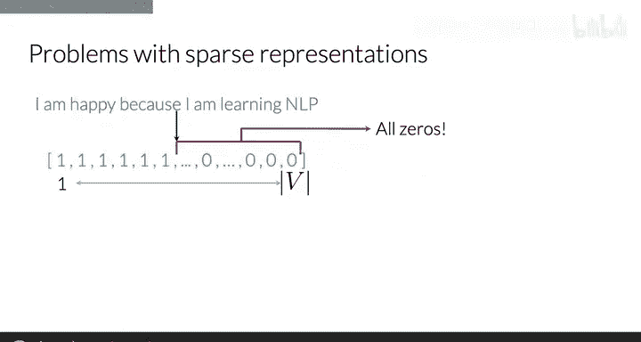
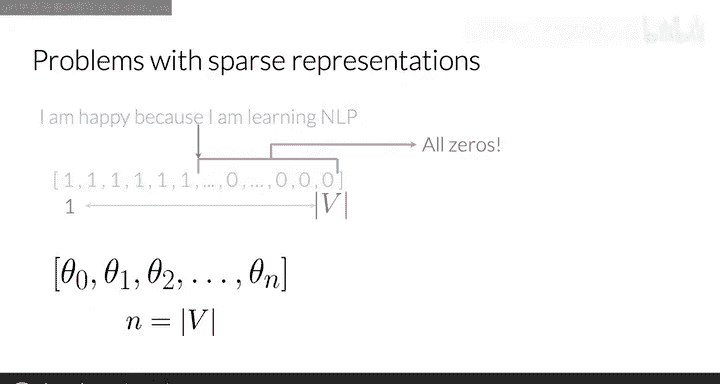
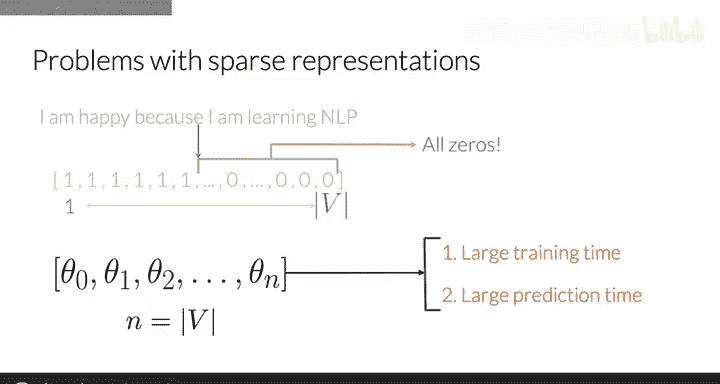

# 吴恩达《自然语言处理｜natural language processing》中英字幕 - P5：4_词汇特征提取.zh_en - GPT中英字幕课程资源 - BV1Hc5ezDEWQ

Hello， welcome back。 In this video， you're going to learn how to represent a text as a vector。

 And in order for you to do so， you first have to build a vocabulary。

 and that will allow you to encode any text or any tweet as an array of numbers。

 So let's dive in and see how you can do this。😊。

Picture a list of tweets。 Visually， it would look like this。

 Then your vocabulary V would be the list of unique words from your list of tweets to get that list。

 you'll have to go through all the words from all your tweets and save every new word that appears in your search。

 So in this example， you'd have the word I， then the word am and happy。😊，Because。And so forth。

But note that the word I and the word M would not be repeated in the vocabulary。

Let's take this tweet and extract features using your vocabulary to do so you'd have to check if every word from your vocabulary appears in the tweet。

If it does， like in the case of the word。I， you would assign a value of one to that feature like this。

If it doesn't appear， you assign the value of 0。Like that。 And in this example。

 the representation of your tweet would have six ones。And many zeros。

 And this correspond to every unique word from your vocabulary that isn't in the tweet。

Now this type of representation with a small relative number of nonzero values is called a spase representation。

Now's take a closer look at this representation of this tweet。In the last slides。

 I walked you through extracting features to represent the suite based on a vocabulary。

 and I arrived at this vector。This representation would have a number of features equal to the size of your entire vocabulary。

And it would have a lots of features equal to 0， for every tweet。With this parse representation。

 a logistic regression model would have to learn n plus1 parameters where n would be equal to the size of your vocabulary。

And you can imagine that for large vocabulary sizes， this would be problematic。

 It would take an excessive amount of time to train your model and much more time than necessary to make predictions。

Given a text， you learned how to represent this text as a vector of dimension V。

 specifically you did this for a tweet， and you were able to build a vocabulary of dimension V。 Now。

 as V gets larger and larger， you will face certain problems In the next video。

 you will learn to identify these problems。