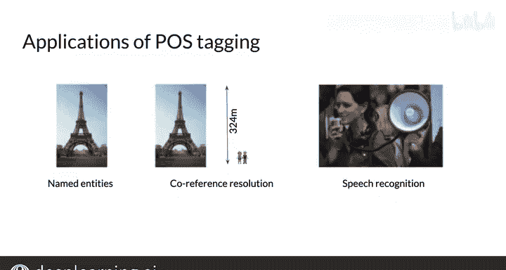

# 吴恩达《自然语言处理｜natural language processing》中英字幕 - P62：12_词性标注.zh_en - GPT中英字幕课程资源 - BV1Hc5ezDEWQ

Welcome to the second week of this course。 In this video。

 you're going to learn about parts of speech sagging。Specifically。

 you will see the different applications that it is used for。

 You will also learn how to compute the accuracy of a part of speech tagger。 First。

 I'll go over what part of speech sagging is。 Then I'll show you how to use socal Markov chains。

 and hidden Markov models to create parts of speech sags for your text corpus。 Next。

 I will introduce the vi B algorithm and demonstrate how it's used in hidden Markov models。

 You'll get to try this on your own with an example。😊。

You're going to apply all of these skills in this week's coding assignments。 It's a big week。

 So let's get started。Partt of speech refers to the category of words or the lexical terms in a language。

 Exles of these lexical terms in the English language would be noun， verb， adjective。

 adverb pronoun reposition， Although there are many others。 Let's take a look at this sentence。

 Why not learn something。Writing out the names of these terms can quickly become cumbersome during text analysis。

 So you're going to use a short representation called tags to represent these categories。

The process of assigning these tags to the words of a sentence or your corpus is referred to as part of speech saging or P taggging for short。

Because P O S tags describe the characteristic structure of lexical terms in a sentence or text。

 you can use them to make assumptions about semantics。 They are used for identifying named entities。

 too， in a sentence such as the Eiffel Tower is located in Paris。

 Eiffel Tower and Paris are both named entities。Tags are also used for co resolution。

 If you have the two sentences， the Eiffel Towers located in Paris。 It is 324 m high。

You can use part of speech sagging to infer that it refers in this context to the Eiffel Tower。 Co。

 right。Another application is speech recognition， where you use parts of speech tags to check if a sequence of words has a high probability or not。

 You now know the different applications of parts of speech sagging In the next video。

 you're going to learn about Markov chains。 and you'll see how you can use them to decode the parts of speech of a certain sentence。

