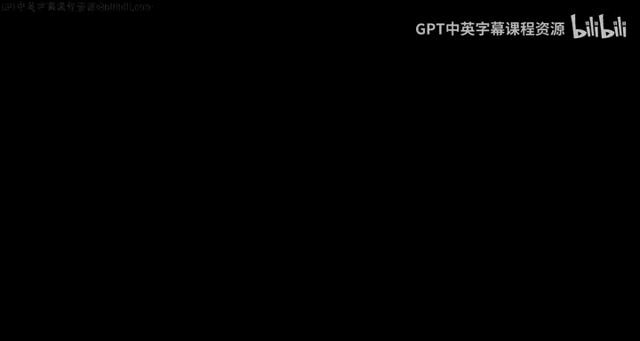
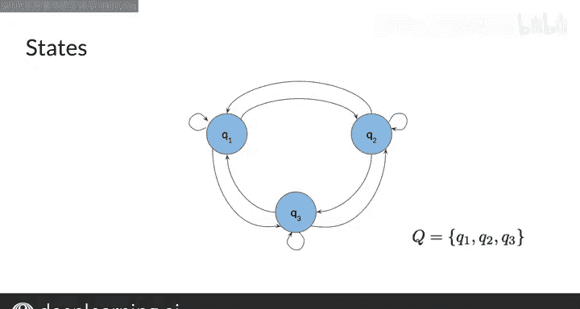

# 吴恩达《自然语言处理｜natural language processing》中英字幕 - P63：13_马尔可夫链.zh_en - GPT中英字幕课程资源 - BV1Hc5ezDEWQ

In this video， you're going to learn about Markov chains。

 Markov chains are really important because they are used in speech recognition。

 and they're also used for parts of speech sagging。 In this video。

 we're going to learn about transition probabilities。

 and you will also learn about states before jumping in let's start with a small example to show what you want to accomplish。

 And then you will see how Markov chains can help accomplish the task。😊，If you look at the sentence。

 why not learn The word learn is a verb。 The question you want to answer is whether the following word in the sentence is a noun。

 a verb or some other parts of speech。If you are familiar with the English language。

 you might guess that if you see a verb in a sentence。

 the following word is more likely to be a nowun rather than another verb。

So the idea here is that the likelihood of the next word part of speech tag in a sentence tends to depend on the part of speech tag of the previous word。

 Make sense， right？ You can represent the different likelihoods visually here。

 you have a circle representing a verb and over here， you have a circle representing a noun。

You can draw an arrow that goes from the verb circle to the noun circle。 So the following arrow。

 you can draw another arrow that goes from the verb circle and loops around back to point at itself。

You can associate numbers with each of these arrows where a larger number means that there is a higher likelihood。

 you're moving from one circle to the other。 In this example。

 the arrow that goes from the verb to the noun may be 0。6。

 whereas the arrow that goes from the verb back to the verb has a 0。2。 The higher number of 0。6。

 means that it's more likely to go from a verb to a noun， as opposed to from a verb to another verb。

This is a great example of how Markov chains work on a very small scale。 So what are Markov chains。

 They're a type of stochastic model that describes a sequence of possible events so that the probability for each event。

 it needs only the states of the previous event。 The word stochastic just means random or randomness。

 So a stochastic model incorporates and models processes does have a random component to them。

A Markov chain can be depicted as a directed graph。So in the context of computer science。

 a graph is a kind of data structure that is visually represented as a set of circles connected by lines。

When the lines that connect the circles have arrows that indicates a certain direction。

This is called a directed graph。 The circles of the graph represent states of our model。

 A state refers to a certain condition of the present moment。 For example。

 if you are using a graph to model whether water is in a frozen state。

 a liquid state or a gas states then you would draw a circle for each of these states to represent the three possible states that water can be at the present moment。

 I' am labeling each states as Q1， Q2， Q3， etc cetera。 to give them each a unique name。

 Then referring to the sets of all states with the capital letter Q for this graph。

 there are three states， Q1， Q2 and Q3。 Next up。 Get ready to use Markov chains to tag parts of speech。

😊。

You now learned about the states in your model， and we said that the states represent the condition or the present moment。

These states could be thought of as part of speech tags。

 maybe one states could correspond to the verbs， another one could correspond to the nouns and so forth。

 So in the next video， we will learn about part of speech tags。

