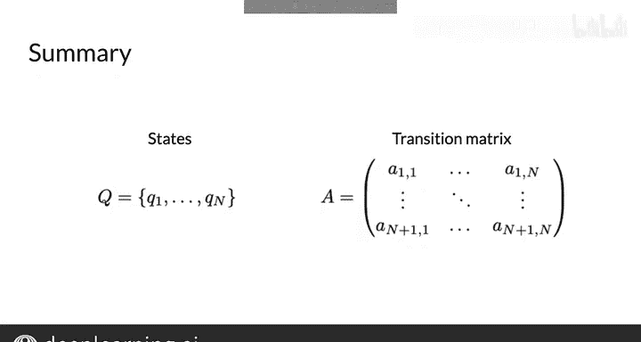

# 吴恩达《自然语言处理｜natural language processing》中英字幕 - P64：14_马尔可夫链与词性标签.zh_en - GPT中英字幕课程资源 - BV1Hc5ezDEWQ

Now you know what states are in this video we're going to introduce parts of speech tag。

 In other words， you will see how you can go from one state to another state。

In doing so， we will define a term as we call transition probabilities。

 These transition probabilities tell you about the chances of going from one pos tag to another。

 If you think about a sentence as a sequence of words with associated parts of speech tags。

 you can represent that sequence with a graph where the parts of speech tags are events that can occur。

 depicted by the states of our model graph In this example， N N is for nouns。

 Vb is for verbs and other stands for all other tags。

The edges of the graph have weights or transition probabilities associated with them。

 which define the probability of going from one state to another。

 There is one last important property that Markov chains possess。 the so-called Markov property。

 Which states that the probability of the next event only depends on the current event。

 The Markov property helps keep the model simple by saying all you need to determine the next state is the current state。

 It doesn't need information from any of the previous states。

 Go back to the analogy of whether water is in solid， liquid or gas state。

 If you look at a cup of water that is sitting outside。

 The current states of the water is a liquid state。

 when modeling the probability that the water in the cup will transition into the gas state。

 you don't need to know the previous history of the water。 whether it previously came from ice cubes。

 or whether it previously came from rain clouds。 that makes sense， right？ Let's revisit the sentence。

This example from earlier。If you look at this sentence again and want to know the probability that the next word following learn is a noun。

 then this just depends on the current state that you're in。 In this case， the verb state。

 denoted by Vb。 because the current word learn is a verb。

 So the probability of the next word being a noun is the transition probability for going from the verb to the noun and n states。

 the transition probability is written on the arrow that goes from Vb to an n。 And as you can see。

 it 0。4。 you can also use a table to store the states and transition probabilities。

A table is an equivalent but more compact representation of the Markov chain model。

 and this table is called a transition matrix。A transition matrix is an n by n matrix。

 with n being the number of states in the graph。Each row in the matrix represents transition probabilities of one state to all other states。

For example， the first row presents the case where the current states is a noun。

 The columns represent the possible future states， as might come next。

The values inside the table represent the transition probability of going from a noun to a noun。

 from a noun to a verb and a noun to some other state。

 notice that for all the outgoing transition probabilities from a given state。

 the sum of these transition probabilities should always be one。Equivalently。

 in the transition matrix， all of the transition probabilities in each row should add up to one。

 Some of you may have noted one little flaw in this model。

 It doesn't tell you how to assign a part of speech tag to the first word in the sentence。

 This is because all of the states in the model correspond to words but what do you do when there is no previous word。

 As in the case， when beginning a sentence to handle this。

 you can introduce what is known as an initial state by you include these probabilities in the table A。

 So now it has dimensions n plus one by n。Notice that the transition matrix can be written as an actual matrix like this。

To recap Markov chains consists of a set Q of n states。 Q1 all the way to Q N。

 The transition matrix A has a dimensions n plus one by n with the initial probabilities in the first row。

 Nice work so far。 I'll see you later。 In this video。

 you learned about initial probability distributions， and you learned about transition probabilities。

 In the next video， you're going to learn about hidden Markov models。

 which are used to decode the hidden states of a word。 In our case。

 that would be the parts of speech of that word。

