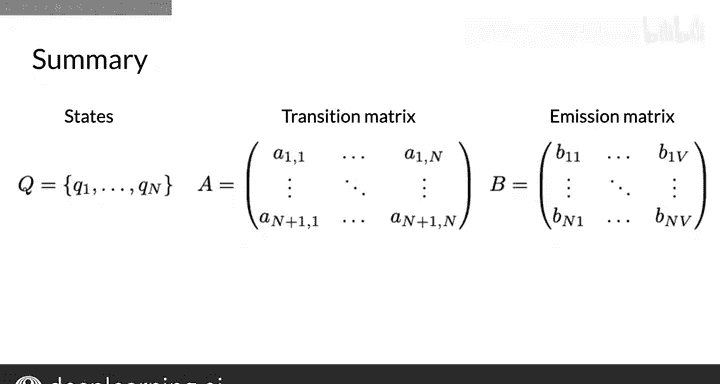

# 吴恩达《自然语言处理｜natural language processing》中英字幕 - P65：15_隐马尔可夫模型.zh_en - GPT中英字幕课程资源 - BV1Hc5ezDEWQ

In this video， you're going to learn about hidden Markov models。

 and you will use them to decode the hidden states of a word。 In our case。

 the hidden states is just the parts of speech of that word。

 You will also learn about emission probabilities in this video。 So let me show you。😊。

The name hidden Markov model implies that states are hidden or not directly observable going back to the Markov model that has the states for the parts of speech such as noun。

 verb or other。 you can now think of these as hidden states because these are not directly observable from the text data。

It may seem a little confusing to think that this data is hidden。

 because if you look at a certain word， such as jump。

As a human who is familiar with the English language， you can see that this is a verb。

From a machine's perspective， however， it only sees the text jump and doesn't know whether it is a verb or a noun。

For a machine looking at the text data， what is going to observe are the actual words such as jump。

 run， and fly。These words are said to be observable because they can be seen by the machine。

The Markov chain model and hidden Markov model have transition probabilities。

 which can be represented by a matrix a of dimensions n plus 1 by n。

 where n is the number of hidden states。The hidden Markov model also has additional probabilities。

 known as emission probabilities。 These describe the transition from the hidden states of your hidden Markov model。

 which are parts of speech seen here as circles for noun， verb and other。

To the observables or the words of your corpus shown here inside rectangles here， for example。

 are the observables for the hidden state V B， which are the words going to eat。

The emission probability from the hidden state verb to the observable E is 0。5。

 This means when the model is currently at the hidden state for verb。

 there is a 50% chance that the observable the model will emit is the word eat。

Here's an equivalent representation of the emission probabilities in the form of a table。

Each row is designated for one of the hidden states。

A column is designated for each of the observables。 For example。

 the row for the hidden state verb intersects with the column for the observable E。 The value 0。

5 is the emission pro of going from the state verb to emitting the observable E。

 the emission matrix representing the probabilities for the transition of your N hidden states representing your part of speech s to the M words in your corpus。

Again。The row sum of probabilities is one。And what you might have realized in this example is that there are emission probabilities greater than zero for all three of our parts of speech sex。

This is because words can have eight different parts of speech tag assigned depending on the context in which they appear。

For example， the word back should have a different part of speech tag in each of the sentences。

The noun tag for the sentence， he lay on his back and the adverb tag for I'll be back。

A quick recap of hidden Markov models。 They consist of a sets of n states。 Q。

 The transition matrix A has dimension N by N， and the emission matrix B has dimension N by V。

You have seen the notation for hidden Markov models。

 you've also learned how to compute the transition and the emission probabilities。

