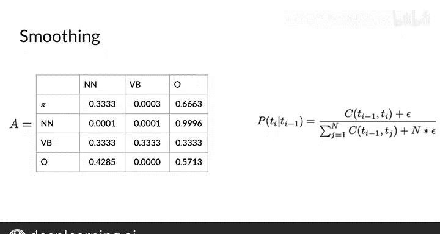

# 吴恩达《自然语言处理｜natural language processing》中英字幕 - P67：17_填充转移矩阵.zh_en - GPT中英字幕课程资源 - BV1Hc5ezDEWQ

To populate the transition matrix， you need to calculate the probability of a tagging happening。

 given that another tag already happened。You also need to calculate the probability that each tag happens at the beginning of the sentence。

You'll also learn about a new concept known as smoothing。 So let's get started。

 begin by filling the first column of your matrix with the count of the associated tags。 Remember。

 the rows in the matrix represent the current state。 and the columns represent the next state。

 The values represent the transition probabilities of going from the current state to the next state。

The states for this use case is the parts of speech tag。 As you can see。

 the defined tags and the elements in the corpus are marked with corresponding colors For the first column。

 you'll count the occurrences of the following tag combinations。 As you see here。

 A noun following a start token occurs once in our corpus。

 A noun following a noun doesn't occur at all。A noun following a verb doesn't occur either。

A noun following an other tag， O， occurs six times。The rest of the matrix is populated accordingly。

 but I'll take a little shortcut。 The corpus， as you can see， is a verbless high cool。

Because there are no tag combinations with the tag VB， they are all0。Unfortunately。

 theres no such shortcuts in the programming assignments。 You've been warned the0 tag。

 the O tag following a start token occurs twice。The Oac following a noun tag and n occurs six times。

 and the last entry in the transition matrix of an Oac following an Otac has a count of8。

In the last line， you have to take into account attacked words on a A。Wes， wet， comma。

And come back to calculate the correct counts。Now that you have calculated the counts of alt tag combinations in the matrix。

 you can calculate the transition probabilities。 so far。

 you've calculated and entered the count in the matrix。

 which corresponds to the numerator in our formula。Now。

 you just have to divide each count by the sum， which is actually the corresponding gr sum。

Remember what this ro sum represents。For the row where the current state is a noun part of speech。

 the sum across that row represents all pairs of words where the current state is a noun。

 And the next state is any part of speech， whether it's a noun， a verb or other。

So for the transition probability of a noun tag， an n following a start token， or in other words。

 the initial probability of a n n tag， we divide  one by3。

 or for the transition probability of an other tag followed by a noun tag， We divide 6 by 14。

 You may have realized that there are two problems here。 One is that the ro sum of the Vb tag is 0。

 which would lead to a division by 0 using this formula。

The other is that a lot of entries in the transition matrix are 0。

 meaning that these transitions will have probability 0。

 This won't work if you want the model to generalize to other highkuus。

 which might actually contain verbs to handle this。

 change your formula slightly by adding a small value epsilon to each of the counts in the numerator。

 and add n times epsilon to the divisor， such that the ros sums still adds up to 1。

 this operation is also referred to as smoothing， which you might remember from previous lessons。

 So if you substitute the epsilon with a small value， say 0。001。

 then you'll get the following transition matrix the values shown here。

 are shown up to the third decimal digit。 So don't worry。

 if the ros sums don't add up to one exactly。The result of smoothing is。

 as you can see that you no longer have any zero valued entries in a further since the transition probabilities from the VB state are actually oneed for all outgoing transitions。

 they are equally likely。 That's reasonable。 since you didn't have any data to estimate these transition probabilities。

 One more thing before you go。In a real world example。

 you might not want to apply smoothing to the initial probabilities in the first row of the transition matrix。

That's because if you apply smoothing to that row by adding a small value to possibly0 valued entries。

 youll effectively allow a sentence to start with any parts of speech tag， including punctuation。

You just learned about smoothing and saw why it is important that is great now in the next video we will move on and see how you can populate another type of matrix known as the emissions matrix。

😊。