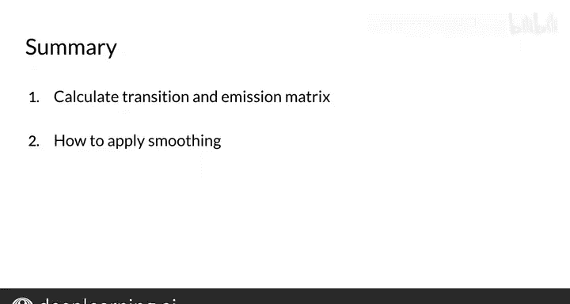

# 吴恩达《自然语言处理｜natural language processing》中英字幕 - P68：18_填充发射矩阵.zh_en - GPT中英字幕课程资源 - BV1Hc5ezDEWQ

In the previous video， I showed you how to calculate the transition matrix。 However。

 knowing the probability of going from one part of speech tag to another alone will not help us much。

 We need to be able to somehow get words into the equation。 Hence。

 we will introduce a new type of matrix that tells you about the probability of going from one word to a part of speech tag。

 till let's dive in going back to your very small training corpus。

 which has the associated parts of speech tag depicted by the background color。

 In contrast to the transition probabilities here， you would want to count the co occurrences of a part of speech tag with a specific word。

😊，For example， the word you appears two times in your corpus。

 zgged with the blue parts of speech tag。And the blue parts of speech tag。Appears three times。

So the emission probability for the word U following the blue parts of speech tag is23。

Let's continue with a more complicated example。 the haiku you processed in the previous lesson。

You have the same tags and can start to fill in the count。 But instead of counting pairs of tags。

 you will now count how often a word is tagged with a specific tag like noun。

 verb or the other tag like it is shown in the first column of the emission matrix for the tag and the word in。

The noun tag is associated zero times with the word in。

The verb tag is associated zero times with the word in tool。

 and the O tag is associated two times with the word in in the corpus。

 The formula with smoothing for the emission probabilities P of W I given the tag T I for the word is given by the counts of T I。

 and the word W I， divided by the corresponding rosom in the emission matrix。

 which is the same as dividing by the total counts of the tag T I。

 with capital n being the number of tags and capital v being the size of our vocabulary to recap。

 you now can calculate both transition and emission matrices。

 and also apply smoothing for better generalization of the model you've come a long way this week。

 Great work。 Given the emission and transition matrices， you will now learn how to use them together。

 in order for you to compute the parts of speech tags of a given sentence。😊。

