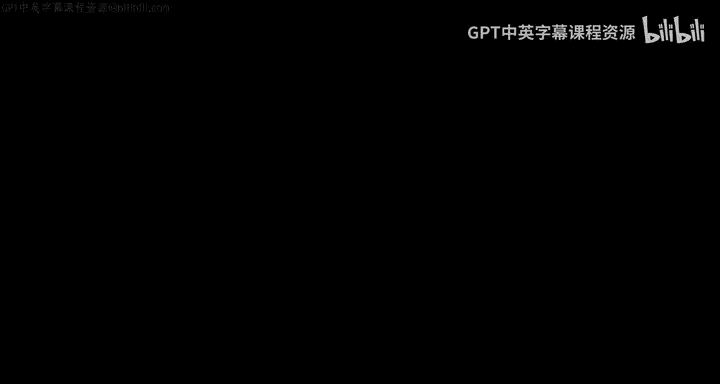
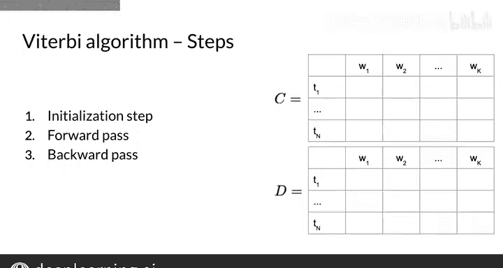

# 吴恩达《自然语言处理｜natural language processing》中英字幕 - P69：19_维特比算法.zh_en - GPT中英字幕课程资源 - BV1Hc5ezDEWQ

You'll now bring everything together and see how the Vi V algorithm works。 Just a heads up。

 This video is a little bit complicated， but I'll walk you through it step by step。 And by the end。

 you'll be able to understand exactly how the vi v algorithm works。 Let's dive in。😊。

So far， you've calculated the transition and emission probabilities for the Markov chain and the hidden Markov model。

 given a part of speech tag and these probabilities。

 you can easily select the most likely next part of speech tag or the most probable word。

 You can do so by looking up the correct entry in the respective row of the transition or emission matrix。

 But what if you are given a sentence like Why not learn something。

 What is the most likely sequence of parts of speech tags given the sentence in your model。

 The sequence can be computed using the vicher B algorithm。

 You're about to see a lot of formulas which are all based on matrices representing our hidden Markov model。

 But the vicher B algorithm is actually a graph algorithm。

 Pickicturing the problem we want to solve on the graph will make it much easier for us to understand the formulas and the algorithm。

 Let's look at this toy model and the sentence。 I love to learn with a leading start token。

 You want to find the sequence of hidden state。😊，Or parts of speech ss that have the highest probability for the sequence。

 Be aware that the word love can be emititted by both the noun state and N and the verb state and N。

You're starting from the initial state pi selecting the next most probable hidden state。

 which here is the O state as the word I cannot be emititted from any other states in this storyy model。

This involves the transition probability shown in green with 0。

3 and the emission probability in orange with 0。5。 The joint probability for observing the word I and with a transition through the O state is 0。

15， which you can calculate by multiplying the transition probability 0。3。

 and the emission probability of 0。5。Now， there are two possibilities of having observed the word love。

 It is either by traversing through the hidden states and N or the hidden states V B。

 the transition probabilities are the same for going to either of the two hidden states。

The emission probability for the word love。Is higher from the VB states。

 So you should choose that path with a combined probability of 0。25。Next。

 you return to the O states as there is no other hidden states with a non zero emission probability for the word2。

The combined probability here is 0。08。 At last， return to the VP states again。

 as there is no other option for this toy model。This step has a combined probability of 0。1。

 The total probability is the product of all the probabilities for the single steps you have chosen。

 which is 0 points 000，3 here。 the vibi algorithm actually compute several such paths at the same time in order to find the most likely sequence of hidden states。

 It uses the matrix representation of the hidden markov model。

 The algorithm can be split into three main steps。 The initialization step。

 the forward path and the backward path， given your transition and emission probabilities。

 you first populate and then use the auxiliary matrices， C and D。

 the matrix C holds the intermediate optimal probabilities。 and matrix D。

 the indices of the visited states。 as you're traversing the model graph to find the most likely sequence of parts of speech tag for the given sequence of words W1。

All the way to WK。 these two matrices have N rows， where N is the number of parts of speech text or hidden states in our model。

And K columns where K is a number of words in the given sequence。

You now know the three steps required to implement the vi B。

 you also saw the two matrices that you'll be populating。

One will allow you to compute the probabilities of each path and the other will tell you which path you ended up taking to recap the three steps required are the initialization。

 the forward pass and the backward pass in the next video， we will start with the initialization。

