# 吴恩达《自然语言处理｜natural language processing》中英字幕 - P6：5_负频率和正频率.zh_en - GPT中英字幕课程资源 - BV1Hc5ezDEWQ

You will now learn to generate counts which you can then use as features into your logistic regression classifier。

 specifically， given a word， you want to keep track of the number of times that word shows up in the positive class。

 and given another word， you want to keep track of the number of times that word showed up in the negative class。

Using both those counts， you can then extract features and use those features into your logistic regression classifier。

 so let's take a look at how you can do that。It is helpful to first imagine how these two classes would look here。

 For instance， you could have a corpus consisting of four tweets and associated with that corpus。

 you would have a set of unique chors， your vocabulary。😊。

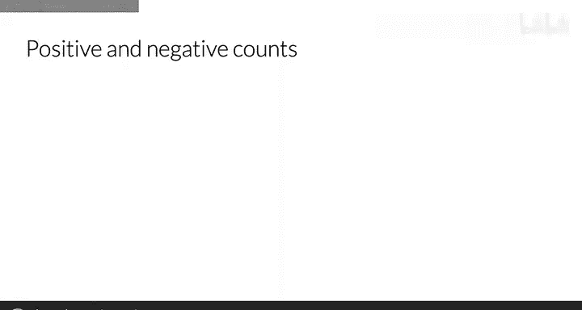

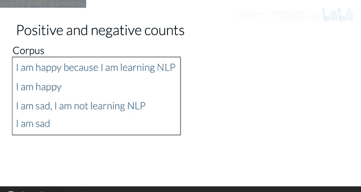

In this example， your vocabulary would have8 unique words。

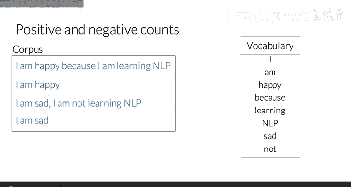

For this particular example of sentiment analysis， you have two classes。

 one class associated with positive sentiment and the other with negative sentiment。

So taking your corpus， you would have a set of two tweets that belong to the positive class and a set of two tweets that belong to the negative class。

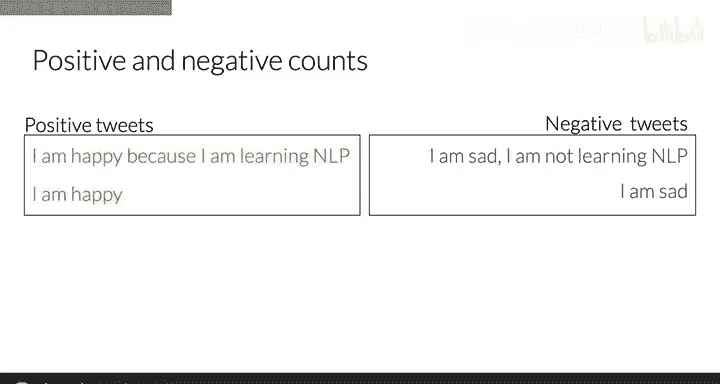

Let's take the sets of positive tweets。 Now， take a look at your vocabulary。

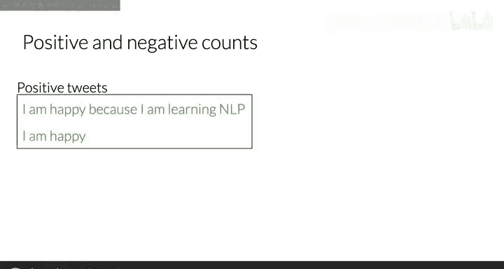

To get the positive frequency of any word in your vocabulary。

 you'll have to count the times as it appears in the positive tweets。 For instance。

 the word happy appears one time in the first positive tweet。😊。

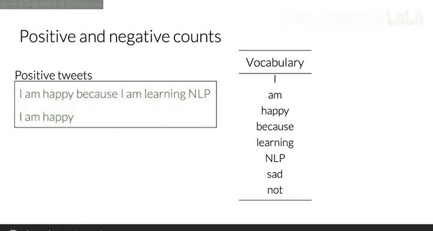

And another time， in the second positive tweet。So its positive frequency is 2。

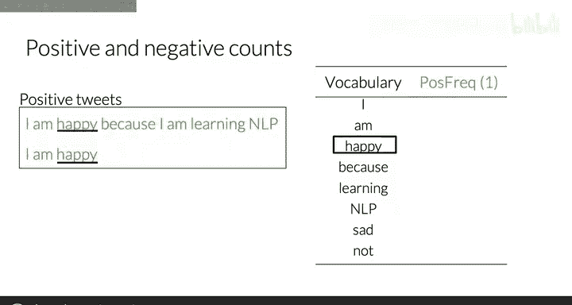

The complete table looks like this。 Feel free to take a pause and check any of its entries。😊。

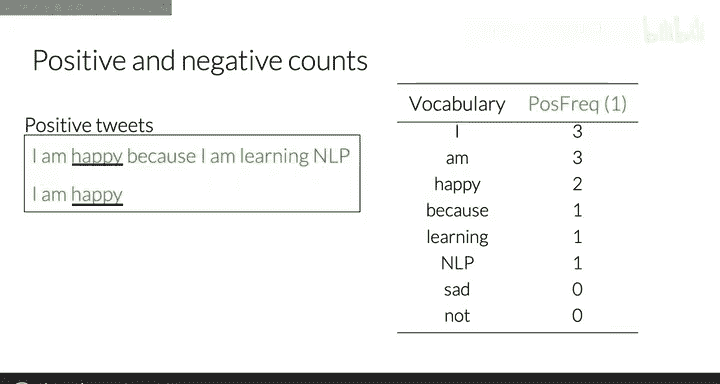

The same logic applies for getting the negative frequency。

However， for the sake of clarity， look at an example。

 the word M appears two times in the first tweet。And another time in the second one。

 So its negative frequency is 3。Take a look at the entire table of negative frequencies and feel free to check its values。

😊。

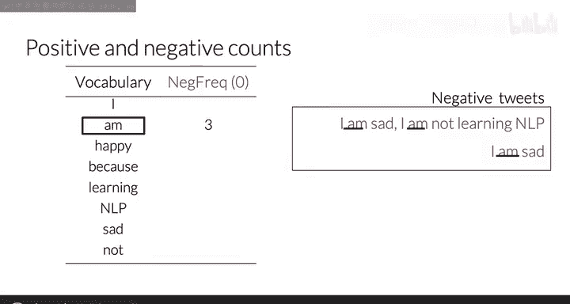

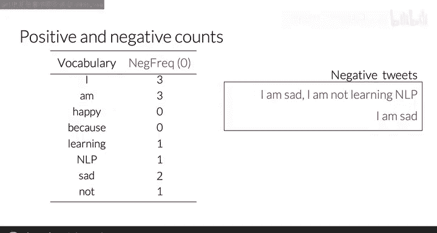

So this is the entire table with the positive and negative frequencies for your corpus In practice。

 when coding， this table is a dictionary mapping from a word class pair to its frequency。

 so it maps the word in its corresponding class to the frequency or the number of times that word showed up in the class。

😊。

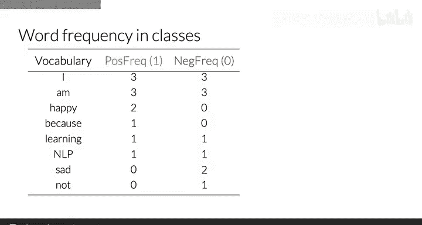

You now know how to create a frequency dictionary which maps a word and the class to the number of times that word showed up in the corresponding class in the next video you're going to use your frequency dictionary to represent a tweet。

