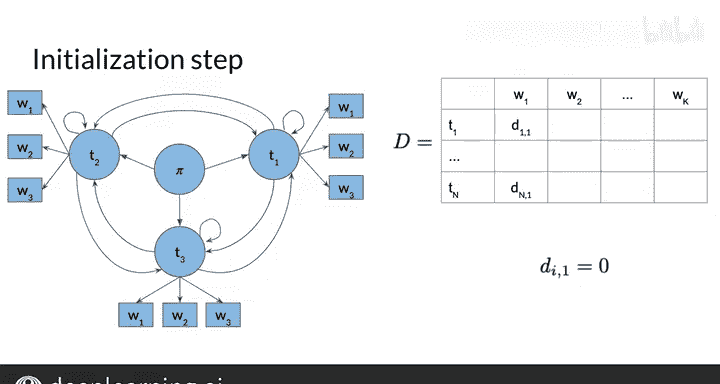

# 吴恩达《自然语言处理｜natural language processing》中英字幕 - P70：20_维特比初始化.zh_en - GPT中英字幕课程资源 - BV1Hc5ezDEWQ

Hello， I will now show you how you can initialize a matrix that can tell you the part of speech tag of every word。

 This matrix will tell you the probability that every word belongs to a certain part of speech tag。😊。

Let me show you how you can do this。 As you just saw。

 the initialization step is one of three steps to populate the auxiliary matrices。

 C and D in the initialization step， the first column of each of our matrices。 C and D is populated。

 The first column of C represents pro of the transitions from the start states pi in the graph to the first tag T I and word W1。

 meaningan we're trying to go from tag1 to the word W1。

 This is shown here for a model with three hidden states for the sake of clarity。

 So the first column entries， C I comma 1 are the product of the transition probabilities of the initial state and the respective emission probabilities as your initial probabilities are contained in the first row of the transition matrix A。

 This is the same as a1 comma I times the corresponding emission probability。B。

 the C index function simply returns the column index in the matrix B for the given word here W1 in the D matrix。

 you store the labels that represent a different states。

 You're traversing when finding the most likely sequence of parts of speech tags for the given sequence of words W1 all the way to W K。

 in the first column， you simply set all entries to 0。

 As there are no preceding parts of speech tags。 we have traversed。 That's it for step 1。

 You now know how to initialize your matrices In the next video。

 you're going to learn how to continue populating your matrices。

 and you can use that to decode the parts of speech of a certain sentence。

 You'll learn about the vi V algorithm。 What you can use for parts of speech sagging and also speech recognition。

