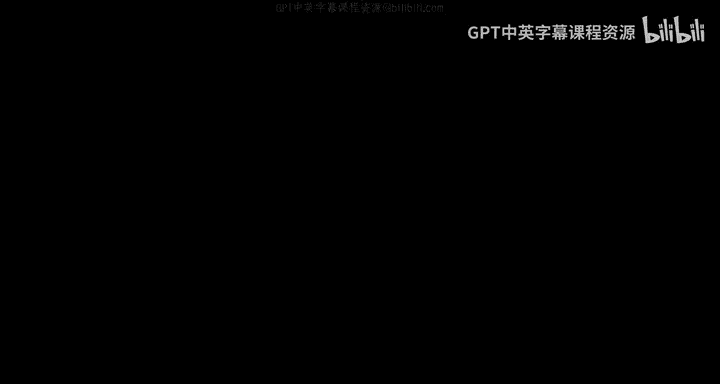
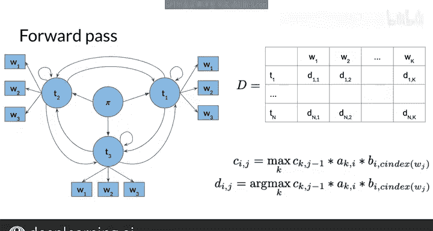

# 吴恩达《自然语言处理｜natural language processing》中英字幕 - P71：21_维特比前向传递.zh_en - GPT中英字幕课程资源 - BV1Hc5ezDEWQ

Hi again。You'll now use the virubi algorithm to continue populating the two matrices you initialized in the previous video。

 You'll see how you can assign part speech tags to certain words in the sentence。

 Let's take a look at how you can do this。 The forward pass is the second of three steps to populate your matrices。

 C and D。😊，Now that you have initialized the matrices C and D。

 all the remaining entries in the two matrices， C And D are populated column by column during the forward pass for the C matrix。

 the entries are calculated by this complicated looking function。

 Let's picture the next step on the graph。 So this becomes clear。

Let's say you want to calculate the entry C1，2。Then you can fill in the values to the formula starting from the last term。

 the last term of the formula is simply the emission probability from tag T1 to word W2。

You have the a K comma 1， which is the transition probability from the part of speech tag T K to the current tag T1 and T K1。

 which represents the probability for the preceding path you've traversed you choose the K which maximizes the entire formula In this case。

 there are three states that are not the initial state。 So K is either one2 or three in each Dj。

 you simply save the K， which maximizes the entry in Cj here there are three states that are not the initial state。

 So K is either one，2 or three。 This is defined by the scary looking formula which is the same as for Cj except the leading Arax。

The Arax function returns the K， which maximizes the function arguments instead of the maximum value。

Almost there。 Just one more step。You now computed the probability matrix using the VicherB algorithm in the next video。

 you're going to see how you can use this probability matrix that you just created to reconstruct the path so that you can identify each word with the parts of speech。

