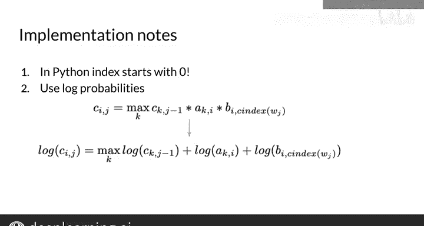

# 吴恩达《自然语言处理｜natural language processing》中英字幕 - P72：22_维特比后向传递.zh_en - GPT中英字幕课程资源 - BV1Hc5ezDEWQ

In this video， I'm going to show you how you can use the probability matrix。

 the one that you learned in the previous video， and I'll show you how you can use it to create a path so that you can assign a part of speech side to every word。

 Let me show you how you can do this。😊，The backward pass is the last of three steps of the vi B algorithm。

 where you will retrieve the most likely sequence of part of speech tags for your given sequence of words。

 By now， you've populated the matrices C and D。 Now。

 you just have to extract the path through your graph from the matrix D。

 which represents the sequence of hidden states that's most likely generated our sequence。

 Word1 all the way toward K。 First， calculate the index of the entry C I K with the highest probability in the last column of C。

 The probability at this index is the probability of the most likely sequence of hidden states generated the given sequence of words。

 You use this index S to traverse backwards through the matrix D to reconstruct the sequence of part of speech tags。

 First， calculate the index of the entry C I K。 with the highest probability in the last column of C。

 The probability at this index。Is the probability of the most likely sequence of hidden states generating the given sequence of words。

 You use this index S to traverse backwards through the matrix D to reconstruct the sequence of parts of speech tag。

 Let's look at a simple example for a matrix D。 for a model with four states and a given word sequence of length 5。

 The matrix D stores all the labels of the hidden states you've traversed in the forward path。

 If you're going back through the states， starting with the path that has the highest probability。

 you effectively got the most likely sequence of hidden states or parts of speech tag。

 You start by looking up the entry with the highest probability in the last row of the matrix C。

 and extract the index S of that entry。Let's look at the matrix C with some probabilities you might have computed in the forward pass。

You now want to calculate the index S of the entry and the last row of C。

 which has the highest probability。The entry with the highest probability is the first one with 0。01。

Written as a formula， S is the Armax I of C I K， which in this case is equal to1。

 That index represents the last hidden state you traversed when you observe the word W5。

 So the most likely state of word W5 is the T1 part of speech tag。

 So you add T1 to the end of the sequence and look up the next index in D。

 which tells you where you came from。 This next index is 3。

 Now move on to the fourth word in the sequence， which means you're now looking at the fourth column in the matrix D。

 to decide which row the matrix to look at， recall that in matrix D column 5。

 the top row holds the value 3 where3 represents the previous state with the highest probability。

So T3 is the most likely state for word number 4， so you would associate word number 4 with the state number 3。

 which is the part of speech label number3。 you can keep walking left to each column of the matrix D Since the value stored in column 4 row3 is the number one。

 you can assign the part of speech Sac T1 to the previous word word number 3。Also。

 when you go left to column 3， you will look for row 1， representing state 1。

 which you see highlighted in green。 The value stored in column 3， row 1 is 3。

 This means that the previous word has part of speech sag number 3 associated with it。

 So associated word number 2 with part of speech sag 3。Now。

 walk left one column in the matrix to column 2。Since the value stored in the green cell in column 3 is 3。

 go to row 3 of column 2 in column 2， the value stored in row 3 is 2。 This means that for word1。

 the most likely state is part of speech sag number 2。

 and the algorithm stops as you have arrived at the start token with the value stored in the second row of the first column being 0。

 The sequence of T I that you have recovered in the backward pass is the sequence of parts of speech sags with the highest probability Before you go。

 there are two implementation specific issues to be aware of。

When you implement the VicherB algorithm in the programming assignment。

 be careful with the indices as list or matrix indices in Python start to a0 instead of one。

Another implementation specific issue is when you multiply many very small numbers like probabilities。

 this will lead to numerical issues， So you should use log probabilities instead。

 where numbers are summed instead of multiplied。Don' worry。

 I'll be revisiting this concept later in the course。 Congratulations on finishing this week。

 You now know about the vi B algorithm， and specifically。

 you've used this for parts of speech tagging。 You can use parts of speech tagging in search in machine translation in speech recognition and also in parsing。

 Next week， you're going to learn about a different type of task。

 which is known as Ngramm language models。😊。

