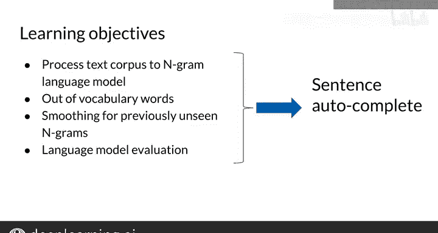

# 吴恩达《自然语言处理｜natural language processing》中英字幕 - P75：25_N元语法概述.zh_en - GPT中英字幕课程资源 - BV1Hc5ezDEWQ

。

And grams are fundamental concepts in NLP。 You can use them in speech recognition， spelling。

 correction， augmentative communication and many other things。 In this video。

 you will see an overview of what you will be learning。 Let's take a look。😊，This week。

 you'll create an Ngram language model from a text corpus recall that a text corpus is typically a large database of text documents。

 such as all the pages on the Wikipedia。All books from one author or all tweets from one account。

 A language model is a tool that calculates the probabilities of sentences。

 You can think of a sentence as a sequence of words。

Language models can also estimate the probability of an upcoming word。

 given a history of previous words。For example， if you begin an email， hello。

 how are your email application may guess that the next word you want to write is the word you。

 as in hello， how are you in the assignment you will build your own engramm language model and apply it to autocomplete a given sentence。

 First， youll process a text corpus into a language model。

 Use of your autocomplete system will provide the starting words of a sentence。

 The model that you will build will then allow you to query for the most likely words following the starts of that sentence。

Then it outputs that as a suggestion to complete the sentence。

While you are going to focus on the autocomplete application this week。

 language models are widely used in other areas as well Laguage models are used in speech recognition to convert the output into real words。

 For example， if an acoustic model converts speech to text and adhere hears I saw a van than the speech to text system can use a language model to know that it's more likely the sentence was I saw a van and not eyes are often。

Language models are also used in spelling correction to identify words that should be replaced based on the sentence therein。

Probabilities are also important for augmentative communication systems。

 These are systems that can take a series of hand gestures from a user to help them form words and sentences。

 People like Stephen Hawking who are unable to physically talk or sign can instead use simple movements to select words from a menu。

 And then the system can speak for them。Word prediction using language models can be used to suggest likely words for the menu。

Here's what you'll be doing this week。First， you will transform your Rotx corpus into a language model which returns the probability of the next word by using the previous words of a sentence。

 Next， you will adapt your language model to deal with words the model hasn't seen during training these words are called out of vocabulary words。

Smoothing is another technique that you can use to deal with previously unseen input。

 probability of unseen words and sentences can still be successfully estimated this way。

 Sthing essentially pretends that each word and phrase appears in the training corpus at least once。

 This helps to calculate the probability， even for unusual words and sequences。 Finally。

 I'll show you how to choose the best language model with the perplexity metric。

 A new tool for your toolkit。When you combine these skills。

 you will be able to successfully implement a sentence auto completion model in this week's assignment。

Now that you have an overview of what you're going to learn。

 we will dive in and start by showing you N grant probabilities in the next video。

