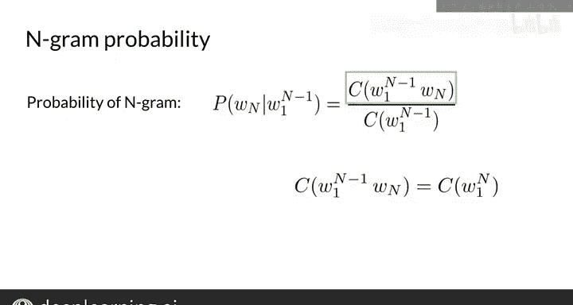

# 吴恩达《自然语言处理｜natural language processing》中英字幕 - P76：26_N元语法与概率.zh_en - GPT中英字幕课程资源 - BV1Hc5ezDEWQ

Welcome， this week， I will teach you N Gm language models。

 This will allow you to write your first program that generates text on its own。First。

 I'll go over what an engram is。 Then you'll estimate the conditional probability of an engram from your tax corpus。

 Now， what is an engram。Simply puts， an Ngram is a sequence of words。

Note that it's more than just a sets of words， because the word order matters。

 Ngram can also be characters or other elements。 But for now。

 you will be focusing on sequences of words。When you process the corpus。

 the punctuation is treated like words， but all other special characters。

 such as coats will be removed。Let's look at an example。

 I am happy because I am learning Uniigrams for this corpus are a set of all unique single words appearing in the text。

😊，For example， the word I appears in the corpus twice， but is included only once in the unigram sets。

 The prefix uni stands for one。Bgrams are all sets of two words that appear side by side in the corpus。

 Again， the bigram， I am， can be found twice in the text。

 but is only included once in the bygram sets。The prefix by means su。Also。

 notice that the words must appear next to each other to be considered a bygram。

Another example of bigram is Im happy。On the other hand， the sequence。

 I happy does not belong to the bygram set， as that phrase does not appear in the corpus。

 I happy is emitmitted， even though both individual words， I and happy appear in the texts。😊。

Trigrams represent unique triplets of words that appear in the sequence together in the corpus。

 The prefix try means 3。Here is some notation that you're going to use going forward。

 If you have a corpus of text that has 500 words， the sequence of words can be denoted as W 1， W 2。

 W 3， all the way to W 500。 The corpus length is denoted by the variable M。

Now for a sub sequenceequence of that vocabulary， if you want to refer to just the sequence of words from word 1 to word 3。

 then you can denote it as W Subscript 1， superscript 3。

To refer to the last three words of the corpus， you can use the notation W Subscript M-2。

 superscript M。Next， you'll estimate the probability of an ngram from aax corpus。

 Let's start with unigrams。For example， in this corpus， I am happy because I am learning。

The size of the corpus is M equals 7。 The count of unigram I is equal to 2。

 So the probability is2 divided by 7 for unigram happy。 The probability is equal to one divided by 7。

 The probability of a unigram shown here as W can be estimated by taking the count of how many times word W appears in the corpus。

 And then you divide that by the total size of the corpus M。

 This is similar to the word probability concept you used in previous weeks。Now。

 let's calculate the probability of bygrams。 Let's start with an example。

 and then I'll show you the general formula in the example I am happy because I am learning what is the probability of the word am occurring if the previous word was I。

😊，It would just be the count of the bigrams I am divided by the count of the unigram I。

 So you get the count of the bygrams I am divided by the count of the unigram I In this example。

 the bigram I am appears twice and the unigram I appears twice as well。

 So the conditional probability of M appearing given that I appeared immediately before is equal to 2 divided by 2。

In other words， the probability of the bigram I am is equal to one。For the bigram， I happy。

 the probability is equal to 0 because that sequence never appears in the corpus。 Finally。

 bigram M learning has a probability of one half。 That's because the word M。

 followed by the word learning， makes up one half of the bigrams in your corpus。

 Here is a general expression for the probability of bygram。😊。

The bigram is represented by the word X followed by the word Y。

 So the probability of the word Y appearing immediately after the word X is the conditional probability of word Y given X。

 The conditional probability of y given X can be estimated as the counts of the bigram X comma Y。

 and then you divide that by the counts of all bigrams starting with X。

 This can be simplified to the counts of the bygram。

 X comma Y divided by the count of all unigrams X。 This last step only works if x is followed by another word。

 Let's calculate the probability of some trigrams。 using the same example from before。

 The probability of the word happy following the phrase I am is calculated as one。

Divided by the number of occurrences of the phrase I am in the corpus， which is too。

 The probability of the trigram or consecutive sequence of three words is the probability of the third word appearing。

 Given that the previous two words already appeared in the correct order。

This is the conditional probability of the third word。

 given that the previous two words occurred in the text。

 the conditional probability of the third word， given the previous two words。

 is the count of all three words appearing divided by the count of all the previous two words appearing in the correct sequence。

 Now that the notation for the count of all three words appearing is written as the previous two words denoted by W subscript1 superscript2 separated by a space。

 and then followed by W subscript 3。So this is just the count of the whole trigram written as a bigram followed by a unigram。

What about if you want to consider any number N， Let's generalize the formula to ngrams for any number N。

 the probability of a word W N following the sequence W1 to W n-1 is estimated as the count of Ngrams W1 to W N divided by the count of Ngram prefix W1 to W n-1。

 notice here that the count of the Ngram for words W1 to W N is written as count of W subscript1 superscript n-1 and then space W subscript N。

This is equivalent to C of W subscript 1 superscript n。 By this point， you've seen ngrams。

 along with specific examples of unigrams， bigrams and trigrams。

 You've also calculated their probability from a corpus by counting their occurrences。

 That's great work。

Now you know what ngrams are and how they can be used to compute the probability of the next word。

 Next， you will learn to use it to compute probabilities of whole sentences。

