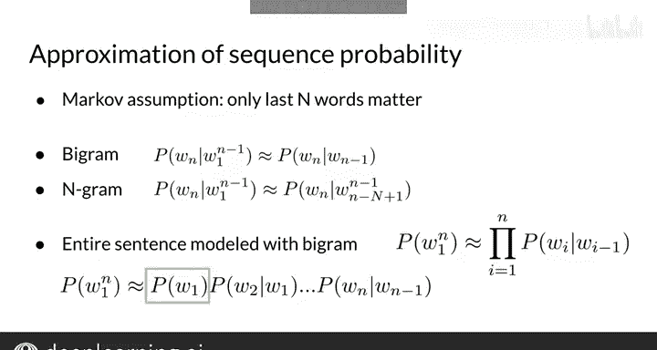

# 吴恩达《自然语言处理｜natural language processing》中英字幕 - P77：27_序列概率.zh_en - GPT中英字幕课程资源 - BV1Hc5ezDEWQ

In this video， I will show you how you can model whole sentences using ngram probabilities。

 This will allow us later to generate some text。So let's find the probability of a sentence or an entire sequence of words。

 How would you calculate the probability of the sentence， The teacher drink tea to get started。

 Let's refresh your memory of the conditional probability and chain rule。Here。

 the conditional probability is a probability of word B。 If word A appeared just before B。

 you can express the rule for the conditional probability in terms of the joint probability of a and B。

 which is B of a comma B， So the probability of B given a is equal to the probability of a and B divided by the probability of a。

 you can rearrange this rule。 so the probability of a and B is equal to the probability of a times the probability of B given a。

 This can be generalized to the chain rule， which describes the joint probability of longer sequences。

 So the probability of a sentence with word A followed by word B。

 followed by word C and word D is equal to the probability of word A times the probability of word B。

 given word A times the probability of word C， given the word A followed by B。

 times the probability of word D。Given by words A followed by B， followed by C， that was a long one。

 but it should make intuitive sense as your eyes follow along the equation。

 The probability of each successive word is the product of the probabilities of all words that came before it in the sequence。

 You can now apply the chain rule to answer your question about the probability of the sentence。

 The teacher drinks tea。The probability of the sentence the teacher drinks tea is equal to the probability of the times the probability of teacher。

 given D times the probability of drinks， given the teacher times the probability of tea given the teacher drinks so youve seen the ideal scenario where you actually have enough data in the training corpus to calculate all of these probabilitybabilities。

 However， this direct approach to sequence probability has its limitations。

 Since natural language is highly variable， your query sentence and even longer parts of your sentence are very unlikely to appear in the training corpus。

 let's use the general probability for the sentence。 the teacher drinks tea。

The formula would look like this。For the final term。

 look for the count of both the input sentence the teacher drinks tea and its prefix。

 the teacher drinks。Since neither of them is likely to exist in the training corpus。

 their counts are 0。 The formula for the probability of the entire sentence can't give a probability estimate in the situation as the sentence gets longer。

 The likelihood that more and more words will occur next to each other in this exact order becomes smaller and smaller。

 So the likelihood that the teacher drinks appears in the corpus is smaller than the probability of the word drinks。

What if instead of looking for all the words before tea， you just consider the previous word。

 which is drinks in this case。This is what those calculations would look like。

The probability of teacher given the， the probability of drinks。

 given teacher and the probability of tea given drinks。 If you multiply these together。

 you'd get an approximation of the whole sentence。 The teacher drinks tea。

 Once the bygram approximation is applied。 The formula to estimate the sentence probability simplified。

 So now it's the product of conditional probabilities of words。 and their immediate predecessors。

 In other words， the product of the probabilities of bygrams。 You just applied the markov assumption。

 instead of looking for all the words。 you just looked at one previous words。

 You also could have considered the two previous words or any n number of previous words。

 The markov assumption states that the probability of each word depends only on its limited history of length N。

 It ignores all the words this game before its specified length n。So for bygrams。

 you approximate the conditional probability of a word W N。

 given the history W1 to Wn-1 by the conditional probability of the word W N， given word W n-1。

 That means you only need to look at the previous word with ngrams you'll only look at n-1 previous words when calculating the conditional probability in the chain rule。

 The bygram formula to estimate the sentence probability is now the product of conditional probabilitybabilities of the words and their immediate predecessors。

 As you may recall， this is， in contrast with naive base where you approximated sentence probability without considering any word history。

 The first term of the bygram formula relies on the unigram probability of the first word in the sentence。

You now know how to compute the probability of a sentence given n grand probabilities Next。

 I'll show you how to compute these n grand probabilities from a corpus。

