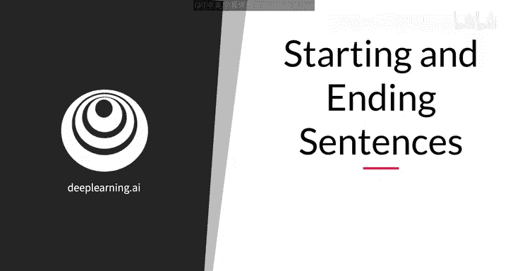
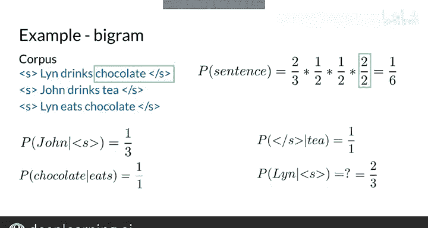

# 吴恩达《自然语言处理｜natural language processing》中英字幕 - P78：28_句子开始与结束.zh_en - GPT中英字幕课程资源 - BV1Hc5ezDEWQ

Good to see you again in this video you're going to learn how to handle the beginning and the end of a sentence when implementing and Gm language models。

So if conditional probabilities are working with a sliding window of two or more words。

 What happens at the beginning or end of a sentence。

 Let's take a closer look at what happens at the very beginning and very end of a sentence。

 I'll show you how to modify the sentence using two new symbols。

 which denote the start and end of a sentence。 You will see why these new symbols are important。

 Then you will add them to the beginning and end of your sentences for by gra and general and gra cases。

Now I'll explain how to resolve the first term in the bigram approximation。

Let's revisit the previous sentence。 The teacher drinks steam。 or the first word the。

 You don't have the context of the previous word， so you can't calculate a bygram probability。

 which youll need to make your predictions。 So what you will do is add a special term so that each sentence of your corpus becomes a bygram that you can calculate the probabilities for an example of a star token。

 I this S， which you can now use to calculate the bygram probability of the first word D like this。

A similar principle applies to engrams。 For example， with trigrams。

 the first two words don't have enough context， So you don't need to use the unigram of the first word and bigram of the first two words。

 The missing context can be fixed by adding two start of sentence symbols。

 bracket S bracket S to the beginning of the sentence。

 So now the sentence probability becomes a product of trigram probabilities。

To generalize this for ngrams， add n-1 star tokens brackets S at the beginning of each sentence。

So now you can deal with the unigrams in the beginning of sentences。

 What about the end of the sentences。Recall that the conditional probability of word Y given word X was estimated as the count of all bygrams。

 X comma Y divided by the counts of all bygrams starting with x。

 You simplify the denominator as the count of all unigrams X。

 There is one case where the simplification does not work。

When word X is the last word of the sentence。For example。

 if you look at the word drinks in this corpus， the sum of all bigrams starting with drinks is only equal to one because the only bigram that starts with the word drinks is drink chocolate。

On the other hand， the word drinks appears twice in the corpus。

 and the other occurrence is a unigram。To continue using your simplified formula for the conditional probability。

 you need to add an end of sentence token。There's another issue with your engram probabilities。

 Let's say you have a very small corpus with only three sentences consisting of two unique chords。

 Yes， and no。The corpus consists of three sentences。 Yes， no， yes， yes。 And no， no。

 These are all possible sentences of length too。 This can be generated from the words yes。

 and no and starting with the starts of sentence symbol brackets S。

 So to calculate the bygram probability of the sentence。 Yes， yes， take the probability of yes。

 with the added start of sentence symbol multiplied by the probability of yes being the second word where the previous word was also yes。

 The probability of yes with the added start of sentence symbol is the count of bygrams with yes。

 at the start of the sentence， divided by the count of all bygrams starting with the start of sentence symbol。

 you can only use the sum of bygram counts in the denominator。 Next。

 let's handle the remaining unigrams。 multiply the first term by the fraction of the count of bygram。

 Yes， yes， over the count of all bygrams starting with the word yes。😊，You get2 over3 times one half。

 which is equal to one over3。 So there you have the probability of the sentence。 Yes， yes。

 estimated from your corpus。 So you have calculated the probability of the sentence。 Yes， yes。

 and gotten one third。 Now you'll calculate the probability of the sentence。 Yes， no。

 and get one third again。Next， get the probability of the sentence。 No， no。And again， wanted。Finally。

 the probability of the sentence， no， yes。 And this is equal to 0， because there is no bygram。 No。

 yes in the corpus。 Now， here comes a surprise。 If you add the probabilities of all four sentences。

The sum equals to one。 Exactly what you are aiming for。 That's great work。 Okay。

 so let's take a look at all possible three word sentences generated from words。 Yes and no。

 begin by calculating the probability of the sentence。 Yes， yes， yes。 Then， yes， yes， no。And so on。

 until you've calculated the probabilities of all eight possible sentences of length 3。 Finally。

 when you add up the probabilities of all the possible sentences of length 3。

 you again get the sum of one。However， what you really want is the sum of the probabilities for all sentences of length to be equal to one so that you can。

 for example， compare the probabilities of two sentences of different lengths。 In other words。

 you want the probabilities of all two word sentences plus the probabilities of all three word sentences。

Plus the probabilities of all other sentences of arbitrary length。

 And you want this to be equal to one。There is a surprisingly simple fix for this。

 You can pre process your training corpus to add a special symbol。

 which represents the end of the sentence， which you will denote with bracket black slash S。

 After each sentence。 For example， when using a bygram model。 for the sentence。

 the teacher drinks tea。Append the symbol back slash S after the word T。 Now。

 the sentence probability calculation contains a new term。

 The term represents the probability that the sentence will end after the word T。

This also fixes the issue with probability of the sentences of certain lengths， equal to one。

Let's see if this also resolves your problem with the bygram probability formula。 Now。

 there are two bygrams starting with the word drinks。 And these are drinks。

 chocolates and drinks back slash S。And count of unigrams， drinks remains the same。 That's great。

 You can keep using the simplified formula for the bygram probability calculation。

 How would you apply this fix for Ngrams in general， It turns out that even for ngrams。

 just adding one symbol per sentence in the corpus is enough。😊，For example。

 when calculating trigram models， the original sentence will be pre processed to contain two star tokens。

 any single end token。 Let's have a look at an example of bigram probabilities generated on a slightly larger corpus。

Here is the corpus。 And here are the conditional probabilities of some of the biograms。Now。

 try to calculate the probability of lean。With the start of sentence symbol。

 there are three sentences total。 So the start symbol appears three times in the corpus。

That gives you the denominator。The bigram brackets Sline。Appears twice in the corpus。

 So that gives you the numerator of two。 So the probability of the start token followed by dean is 2 over 3。

 Now， calculate the probability of the sentence。 lean drinks chocolate。

Start with the probability of bigram， bracket s leanan， which is2 over 3。Then lean drinks。

 which is one half。Then drinks chocolate， which is also one half。And finally， chocolate backslash S。

 which is2 over2。 Know that the result is equal to 1 over 6。

 which is lower than the value of one over 3 you might expect when calculating the probability of one of the three sentences in the training corpus。

 This also applies to the other two sentences in the corpus。

 This remaining probability can be distributed to other sentences possibly generated from the bigrams in this corpus。

 And that's how the model generalizes。

I'll see you later。In this video， you saw an example of beginning in end tokens with bygram models。

 This concept could be generalized to other types of models In the next video。

 you will learn how to build your first and gra language model。

