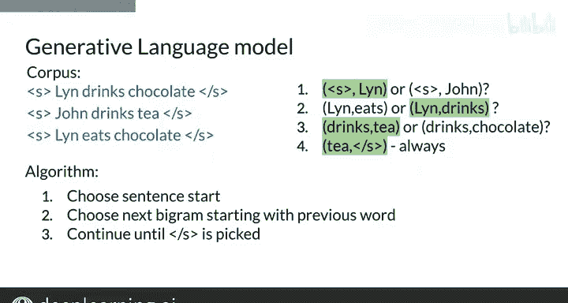

# 吴恩达《自然语言处理｜natural language processing》中英字幕 - P79：29_N元语法语言模型.zh_en - GPT中英字幕课程资源 - BV1Hc5ezDEWQ

I am going to show you how to populate and create a count matrix， which， for example。

 in the case of bygrs， tells you how many times each word is followed by every other word。

 I will show you how to calculate probabilities and even how to avoid underflow when multiplying a lot of numbers between 0 and1。

 So let's get started。😊，First， you will process the corpus into a count matrix that captures the number of occurrences of relative n gras。

 Next， you will transform the count matrix into a probability matrix that contains information about the conditional probability of the n grams。

 Then you will relate the probability matrix to the language model。

 I will also show you how to deal with technical issues that arise from multiplying a lot of small numbers when calculating the sentence probability。

The last section briefly describes how to use the Ngram language model to generate new sentences from scratch。

 So let's start with the count matrix。Here is a reminder of the formula for testing the conditional probability of an Ngram lowercase end the notes where the Ngram ends in a sentence。

The account matrix captures the numerator for all n grams appearing in the corpus。

 All unique corpus and -1 grams make up the rows， and all unique words of the corpus make up the columns。

Now look at the count matrix of a bygram model for the corpus I study， I learn。

The rows represents the first word of the bigram， and the columns represent the second word of the bigram for bygram study。

 I。 you need to find a row with the word study and a column with a word I。

 This bigram appears just once in the corpus。 The whole count matrix can be treated in a single pass through the corpus。

 You can do that by reading through the corpus with a sliding window composed of two words to represent your bygram。

For each bigram you find， you increase the value in the count matrix by one。

Let's move on to the probability matrix Now that you've used the count matrix to provide your numerator for the Ngram probability formula。

It's time to get the denominator。 First， update the count matrix by calculating the sum for each row。

Then normalize each cell。 You can do that by dividing each cell by the corresponding gruesome。

The ro sum is equivalent to your count of the n-1 gram prefixes from the formulas denominator。

 This will always be true。Since the n-1 gra prefix is always followed by some word。

 If the prefix was at the end of the sentence。It is now followed by the end of the sentence token。

 Let's create a probability matrix from an example。 First。

 calculate the sum of bygram counts for each row。 Then divide each cell by the rows sum。

 Let's look at one example， the prefix I is followed by study or by learn。

 As you can see in the count matrix。 If you add up those two instances。

 you'll see that the word I appears twice。 Now， let's go back to the probability matrix。

 You can see that the probability of I study is one half。

 and the probability of I learnn is also one half。The next step is to connect the probability matrix with your definition of the language model from this week's overview。

 The language model can now be a simple script that uses the probability matrix to estimate the probability of a given sentence。

 It estimates the probability by splitting the sentence into a series of n gras and then finding their probability in the probability matrix。

Alternatively， the language model can predict the next elements of a sequence by extracting the last n-1 gra from the end of a sequence。

 After that， the language model finds the corresponding row in the probability matrix and returns the word with the highest probability。

 using the probability matrix from the previous slide。 Find the probability of the sentence I learn。

 You take 1 times 0。5 times 1， which equals 0。5。You have a 50% chance of seeing the sentence I learn next in your corpus。

 That's cool。There are a few loose ends in the language model implementation。 Let's discuss them。

The sentence probability calculation requires multiplication of a lot of small numbers。 In fact。

 all of the probabilities fall in the interval 0 to1。

 and multiplying many probabilities brings the risk of numerical underflow。

You may remember this from previous modules。 All you need to know is that computers have difficulty storing very small decimal numbers。

 and this can end up causing errors。 If you have an opportunity to store a larger number instead。

 you should。 you may recall the mathematical trick for solving this where you wrote the product of terms as the sum of other terms。

 the logarithm of a product。One interesting application of language models is text generation from scratch。

Or using a small hint。For example， the algorithm chooses brackets asne to start。Next。

 it chooses a bigram with lean。In this case， lean drinks。Then it chooses drink tea。 And finally。

 it chooses to end the sentence there。This happens for all bigrams starting with T in your corpus。

 This is how the algorithm accomplishes this。First， it randomly chooses among all bygrams。

 starting with the starts of sentence symbol brackets S。Based on the bygram probability。That means。

The bigrams with higher values in the probability matrix are more likely to be chosen。Next。

 the algorithm chooses a new bygram， a random from the bygrams beginning with a previously chosen word。

Then this byogram is added to your sentence。 The algorithm continues on like this。

 until the end sentence token， bracket backslash S is chosen。As you might have guessed。

 this is done by randomly choosing a bigram that starts with the previous word and ends with the backslash S。

Now you know how to calculate and grant probabilities from a corpus so we can build your own language model。

Next， I'll show you how to evaluate it。