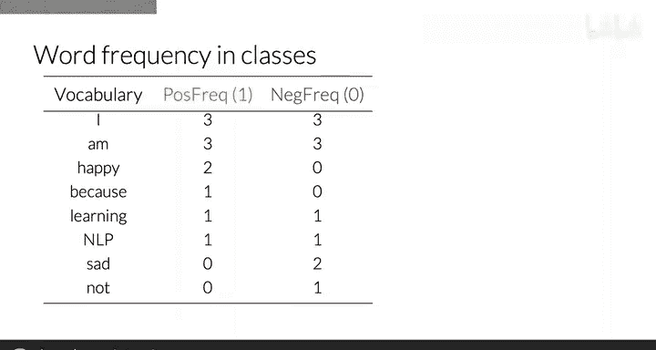
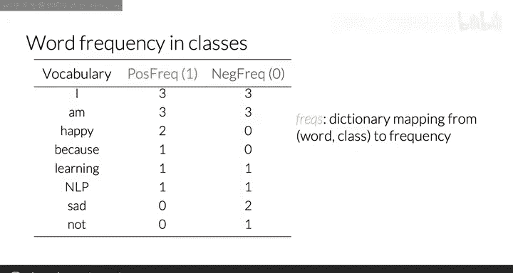
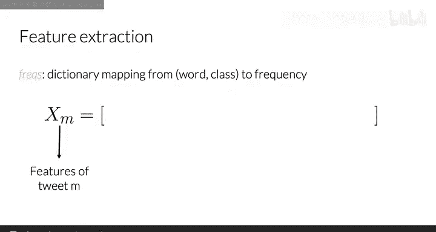
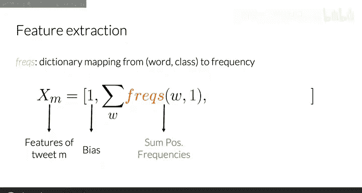
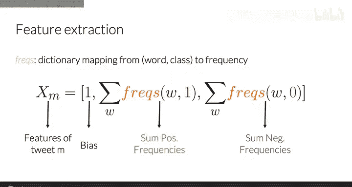
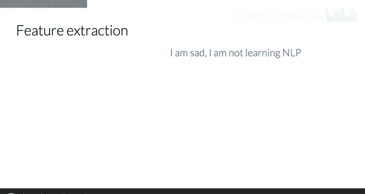
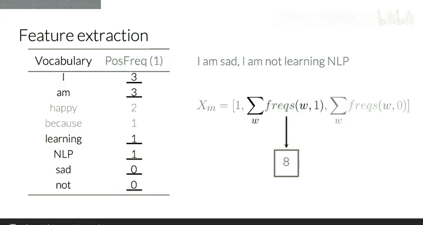
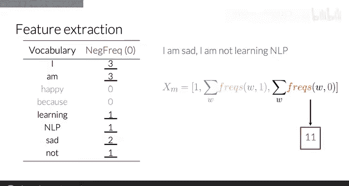
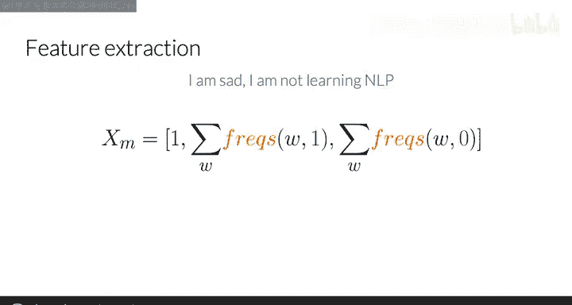

# 吴恩达《自然语言处理｜natural language processing》中英字幕 - P7：6_使用频率进行特征提取.zh_en - GPT中英字幕课程资源 - BV1Hc5ezDEWQ

Welcome back。 You previously learned to encode a tweet as a vector of dimension V。

 You will now learn to encode a tweet or specifically represent it as a vector of dimension 3。

 In doing so， you will have a much faster speed for your logistic regression classifier because instead of learning V features。

 you only have to learn three features。 Let's take a look at how you can do this。

You just saw that the frequency of a word in a class is simply the number of times that the word appears on the set of tweets belonging to that class。

 and that a table is basically a dictionary mapping from word class pairs to frequencies。

 or it just tells us how many times each word showed up in its corresponding class。

Now that you've built your frequencies dictionary， you can use it to extract useful features for sentiment analysis。

What does the feature look like， Let's look at the arbitrary tweet M。

 The first feature would be a bias unit， equal to one。

The second is the sum of the positive frequencies for every unique word on tweet M。

 And the third is the sum of negative frequencies for every unique word on the tweet。

So to extract the features for this representation， you'd only have to some frequencies of words。

 easyas， right。

For instance， take the following tweet。Now， let's look at the frequencies for the positive class from the last lecture。

😊。

The only words from the vocabulary that don't appear on the tweet are happy and because。Now。

 let's take a look at the second feature from the representation that you saw in the last slide。

To get this value， you'll need to sum the frequencies of the words from the vocabulary that appear on the tweet。

At the end， youll get a value equal to 8。

Now， let's get the value of the third feature。It is the sum of negative frequencies of the words from the vocabulary that appear on the tweet。

For this example， you should get 11 after summing up the underlyingd frequencies。

So far this tweets， this representation would be equal to the vector 1，8，11。

You now know how to represent a tweet as a vector of dimension 3 in the next video you will learn to preprocess your tweet。

 and as a result you will use those preprocessed words as words of your vocabulary。

