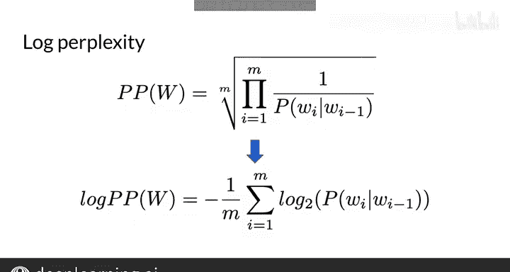

# 吴恩达《自然语言处理｜natural language processing》中英字幕 - P80：30_语言模型评估.zh_en - GPT中英字幕课程资源 - BV1Hc5ezDEWQ

In this video， I'll show you how to evaluate a language model。

 The metric for this is called perplexity。 And I'll explain what this is。 First。

 you will divide the text corpus into trained validation and test data。

 Then you will dive into the concept of perplexity。

 An important metric used to evaluate language models。

 So how can you tell how well your language model is performing。

 recall from the previous videos that a language model assigns a probability to each sentence。

 The model was trained on a corpus。 So for the training sentences。

 it may assign very high probabilities。 You should therefore first split the corpus to have some testing and validation data that are not used for the training。

As you may have done in the other machine learning projects。

 you will create the following splits of training， validation and test sets。

The training set is used to train your model。 The validation set is used for things like tuning hyperparameters。

 and the test set is held out for the end， where you test it once and get an accuracy score that reflects how well your model performs on unseen data a commonly used split for smaller data sets is 801010 or 80% of training 10% of validation and 10% to testing in a very large data sets such as text analysis testing could make up as little as 1% of your training sets。

In NLP， there are two main methods for splitting。You can split the corpus by choosing longer continuous segments like Wikipedia articles。

 or you can randomly choose short sequences of words， such as those in the sentences。

Now that you have split the dataset set， you can evaluate the test sets using the perplexity metric。

Perplexity is a commonly used metric in language modeling。

But what does it mean if you're familiar with the word perplexed。

 you know that a person is perplexed， when they are confused by something very complex。

 you could think of perplexity as a measure of the complexity in a sample of texts。

 like how complex that text is perplexity is used to tell us whether a set of sentences。

 look like they were written by humans， rather than by a simple programme choosing words a random。

A text that is written by humans is more likely to have a lower perplexity score。On the other hand。

 a text generated by random word choice would have a higher perplexity。

Let me show you how to calculate the perplexity of the model。

 Youll start by computing the probability of all sentences in your test set and then raise the probability to the power of negative1 over M。

Rplexity is basically the inverse probability of the test set normalized by the number of wordss in the test set。

So the higher the language model estimates the probability of your test set。

 the lower the perplexity is going to be as a side note worth mentioning。

 perplexity is closely related to entropy， which measures uncertainty。

 Let's look at an example of two language models that are going to return different probabilities for your test sets W。

There are 100 words in the test sets， so M is equal to 100。The first model returns a 0。

9 probability of the test set。Which is very high。This means that the first model predicts your test sets very well。

 so the model is highly effective。As you can see， the perplexity for that model and test set is about one。

 which is very low。The second model returns a very low probability for your test sets。

10 to the power of negative 250。For this model in testa， the perplexity is equal to about 316。

 which is much higher than the first model。So one thing to remember is that the smaller the perplexity score。

 the more likely the sentence is to sound natural to human ears for context。

 good language models have perplexity scores between 60 to 20， sometimes even lower for English。

 perplexities for character level language models where you track characters instead of words will be lower。

 Now we get ready to calculate perplexity for by gra models in a bygram model。

 you calculate the product of by gra probabilities of all sentences。

 Then take the power of negative one over M。 recall that the power of negative one over M of the probability is the same as the order root of one over probability。

One thing to notice here is that in the case of the same probability for different test sets。

 the bigger the sets m is the lower the final perplexity is going to be。

 if all sentences in the test sets are concatenated。

 the formula can be simplified to the product of probabilities of biograms in the entire sets。

One other thing to note is that some papers use log perplexity instead of perplexity。

So the perplexity formula changes from the or root of1 over probability to1 over m times the sum of the logarithms of the probabilities of words。

This is easier to compute， so it's not uncommon to find researchers reporting the log perplexity of language models notes that the logarithm to the base2 is typically used in a good model with perplexity between 20 and 60。

 log perplexity would be between 4。3 and 5。9 Now， how does the improved perplexity translate in a production quality language model。

 here is an example of a Wall Street journal corpus。 If you take a unigram language model。

 the perplexity is very high。962。 This just generates words by their probability。

With a bygram language model， the text starts to make a little more sense。Using a trigram。

 you can see the language it produces is pretty close to reasonable。

 The perplexity is now equal to 1，0，9， much closer to the target perplexity of 20 to 60。

 I mentioned earlier， later in the specialization youll encounter deep learning language models with even lower perplexity scores。

 You now understand what perplexity is and how to evaluate language models。

 to use them for real tasks。 We will need to be able to handle words that did not occur in the training set。

 I'll show you how to do that in the next video。