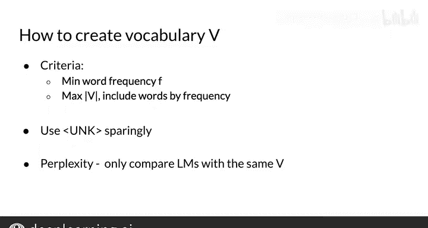

# 吴恩达《自然语言处理｜natural language processing》中英字幕 - P81：31_词汇表外词.zh_en - GPT中英字幕课程资源 - BV1Hc5ezDEWQ

In some applications of language models， you will encounter words that you did not see during the training In this video。

 I'll teach you what to do in such cases。

First， I'll explain what unknown words mean in this context。

 otherwise known as out of vocabulary words， then you'll add a new special word unc to your probability calculations from the training corpus。

 I will also share a few techniques to help you choose which words are considered known by building a vocabulary。

What are out of vocabulary words。First， a vocabulary is a set of unique words supported by your language model in some tasks like speech recognition or question answering。

 you will encounter and generate only words from a fixed sets of words。 For example。

 a chat bot can only answer a limited set of questions。

 This fixed list of words is also called closed vocabulary。 However。

 using a fixed set of words is not always sufficient for the task。Often。

 you have to deal with words you haven't seen before。 Which results in an open vocabulary。

 Open vocabulary simply means that you may encounter words from outside the vocabulary。

 like a name of a new city in the training set。The unknown words are also called out of vocabulary words。

 or O， O V for shorts。 One way to deal with the unknown words is to model them by a special word unc。

 To do this， you simply replace every unknown word with unc。Here。

 you will process your training corpus to generalize it for unknown words。First。

 define which words belong to the vocabulary。Any word in the training corpus that's not in the vocabulary will be replaced with Unc。

And now you can apply the Ngram language model probability calculations in the same ways before。

 just with the addition of Unc。 Here's an example of how you can create the vocabulary and replace rare words with Unk。

This is your input training corpus， where youve decided that a vocabulary in vocabulary needs to appear in your corpus at least twice。

 In other words， the minimal frequency of the word is2。

 This is your updated corpus After replacing all words with frequency smaller than two with onc。

Vocabulary is then a set of words with frequency greater than or equal to2 when using the language model on an input query。

 any words in the query that are outside the vocabulary are also replaced with Unk。

 So as you see here the probability calculation is applied to the input query with onc replacing the out of vocabulary word aom。

Later in this specialization， I will show you some other methods to deal with unknown words。

 For example， you could spell them out character by character using deep learning。All in good time。

Let's talk about how to decide on the words you want included in vocabulary V。

 you can create a vocabulary from the training corpus based on different criteria。 For example。

 you could choose the minimum word frequency F， that is usually a small number。

 the words that occur more than F times and the corpus will become parts of the vocabulary V。

Then replace all other words， not in the vocabulary with unc。 This is a simple heuristic。

 but it guarantees that the words you care about， the ones that repeat a lot are parts of the vocabulary。

Alternatively， you can decide what the maximum size of your vocabulary is and only include words with the highest frequency up to the maximum vocabulary size wanting to consider is the influence of as on the perplexity。

Is it going to make it lower or higher。Actually， it's usually lower。

So it will look like your language model is getting better and better。But watch out。

You might just have a lot of unks。 The model would then generate a sequence of unk wordss with high probability instead of meaningful sentences。

Due to this limitation， I would recommend using uns sparingly。Finally。😊。

When using the perplexity metric， remember to only compare language models that have the same vocabulary。

Now you know how to deal with out ofward vocabulary words Next I'll show you a method to improve performance on rare words。

