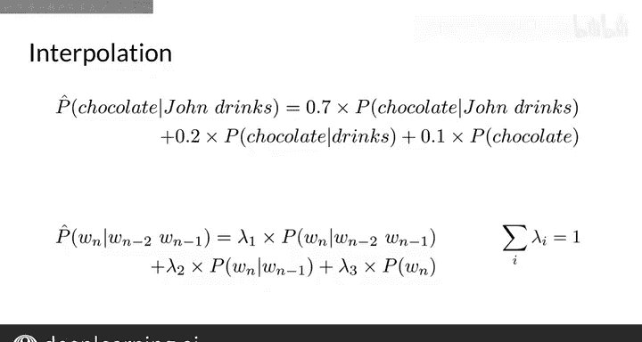

# 吴恩达《自然语言处理｜natural language processing》中英字幕 - P82：32_平滑.zh_en - GPT中英字幕课程资源 - BV1Hc5ezDEWQ

When you train an Ngram on a limited corpus， the probabilities of some words may be skewed in this video。

 I'll show you how to remedy that with a method called smoothing。First。

 you will see an example of how Ngrams missing from the corpus affect the estimation of Ngram's probability。

 Next， I'll go over some popular smoothing techniques。 In the last section。

 I'll touch on other methods such as backoff and interpolation。

Now that you've resolved the issue of completely unknown words。

 it's time to address another case of missing information。 For example。

 how would you manage the probability of an Ngram made up of words occurring in the corpus。

 but where the engram itself is not present。Remember。

 you had a corpus of three sentences earlier made up of engrams like eat chocolate， John drinks。

Notice that both of the words John and Eats are present in the corpus。

 but the bygram John eatats is missing。The counts of the bygram John Es would be 0。

 and the probability of the bigram would be 0 as well。

 Everything that did not occur in the corpus would be considered impossible。

 An estimation of the probability from counts wouldn't work in this case。

Smoothing is a technique that can help you deal with the situation in N gra models。

 You might remember smoothing from the previous week。

 where it was used in the transition matrix and probabilities for parts of speech Here。

 you'll be using this method for N gra probabilities。 What does smooththing mean。

Let's focus for now on add one smoothing， which is also called lapplian smoothing add one smoothing mathematically changes the formula for the ngram probability of the word n based off its history。

Here you can see the bygram probability of the word W N， given the previous words， W n-1。

 but it's used in the same way to general n grams Add one smoothing just says let's add one both to the numerator and to each bigram in the denominator sum。

This change can be interpreted as add one occurrence to each bygram。

So biograms that are missing in the corpus would now have a non0 probability in the denominator。

 you are adding one for each possible bigram， starting with the word W n-1。

This corresponds to adding one to each cell in the row indexed by the word Wn-1 in the count matrix。

Then repeat this for as many times as there are words in the vocabulary。

You can take the one out of the sum and add the size of the vocabulary to the denominator。

This will only work on a corpus where the real counts are large enough to outweigh the plus1， though。

Otherwise， the probabilities of missing words would be too high。

 but at one smoothing helps quiet a lot because now there are no by grounds with0 probability。

If you have a larger corpus， you can instead add K。

 this technique called add case movinging makes the probabilities even smoother。

The formula is similar to add once smoothing。Simply add。

K to the numerator in each possible N gra in the denominator where it sums up to K by the size of the vocabulary。

 So Kat's smoothing can be applied to higher order and gram probabilities as well， like trigrams。

4 gras and beyond。There are even more advanced movinging methods like the ker eye or good turing。

 Another approach to dealing with n gras that do not occur in the corpus is to use information about n-1 gras。

 N-2 gras and so on with back off if n gram information is missing， you use n-1 gram。

 If that's also missing， you would use n-2 gram and so on。

 until you find non0 probability using the lower level n gras。 I。

e n-1 gram and-2 gra down to unigram。It distorts the probability distribution。

 especially for smaller corporal。Some probability needs to be discounted from higher level engrams to use it for lower level engrams。

 This cats back off method uses discounting。In very large web scale corusees。

 a method called stupid backoff has been effective。With stupid backoff。

 no probability discounting is applied。 If the higher order in gra probability is missing。

 the lower order in gra probability is used just multiplied by a constant， a constant of about 0。

4 was experimentally shown to work well。 Let's use backoff on an example。 If you look at this corpus。

 The probability of the trigram drawn drink chocolate can't be directly estimated from the corpus。

So the probability of the bygra， drinks chocolate multiplied by a constant in your scenario 0。

4 would be used instead。An alternative approach to back off is to use the linear interpolation of all orders of ngrams。

 That means that you would always combine the weighted probability of the ngram and -1 gra down to unigrams。

For example， when calculating the probability for the trigram， John drinks chocolate。

 you could take 70% of the estimated probability for trigram。

 so John drinks chocolate plus 20% of the estimated probability for bygram drinks chocolate and 10% of the estimated unigram probability of the word chocolate。

More generally for trigrams， you would combine the weighted probabilities of trigram。

 bigram and unigram。You weigh all these probabilities with constants like Lambda， 1， Lambda 2。

 and Lambda 3。These need to adapt to one。The Ladas are learned from the validation parts of the corpus。

 You can get them by maximizing the probability of sentences from the validation sets。

Use a fixed language model trained from the training part of the corpus to calculate n probabilities and optimize the Ladas。

The interpolation can be applied to general ngrams by using more lambdas。

Now you're an expert in NgramM language models， you know how to create them。

 how to handle out of vocabulary words， and how to improve the model with smoothing you'll see that they work really well in the coding exercises where you will write your first program that generates text。

