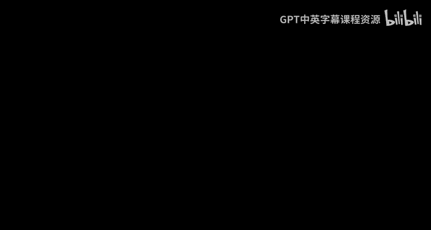
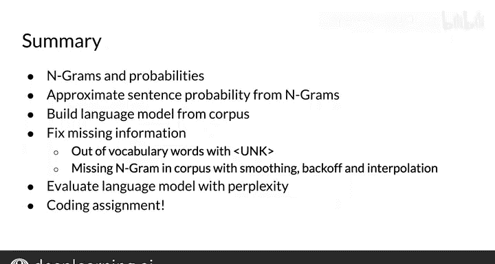

# 吴恩达《自然语言处理｜natural language processing》中英字幕 - P83：33_周总结.zh_en - GPT中英字幕课程资源 - BV1Hc5ezDEWQ

Congratulations for making it all the way here in this video we're going to do a quick recap of everything you learned and highlight the main decos。

So for that， you have seen Ngram language models， computing probabilities and handling text。

 Let's take a look at the overview in more detail。Let's take a moment to reflect on everything you accomplished this week。

 You began with the definition of engrams and how to calculate their probabilities from a corpus。

 Then you combine the engram probabilities to approximate the probability of a sentence Organ information about all engrams in the corpus helped you to build a language model。

 a tool that estimates the probability of any sentence。

You also resolved situations where information about some parts of the sentence was missing。

You handle this in several ways by transforming your model to deal with outs of vocabulary words。

 using special enco and by applying several methods to handle missing engrams in the corpus。

 such as smoothing， back off and interpolation。Finally。

 you acquired a tool to help you choose the best language model for your task， the perplexity metric。

Now， you're ready to take on your assignment， sentence auto complete。

You've done amazing work this week， and I hope you've enjoyed it。 Best of luck on your assignment。

 and I'll see you later。😊。

You have gone a long way and you learned a lot of important concepts in this week andgrams are foundational and allow you to get a better understanding when you go into more technical models later in specialization。

The programming assignments will strengthen your understanding of this concept。

 Good luck and see you next week。😊。