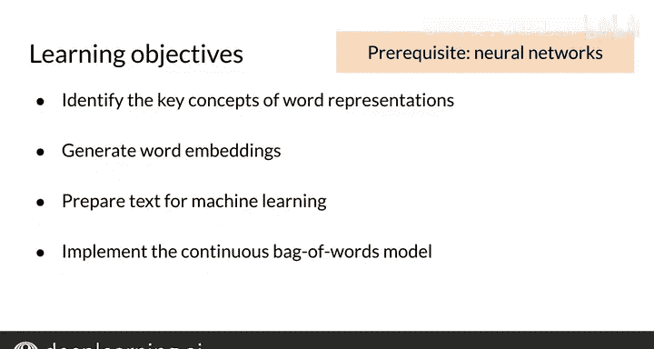

# 吴恩达《自然语言处理｜natural language processing》中英字幕 - P86：36_概述.zh_en - GPT中英字幕课程资源 - BV1Hc5ezDEWQ

Welcome to this week you're now going to learn about word vectors and specifically you're going to see how you can train them from scratch previously you just downloaded word vectors and used them。

 but in this week you're going to be able to train them in this video you're going to learn about the different applications of word vectors and then you're going to learn about the different ways of training word vectors。

😊，Word vectors， also known as word embeddings are the cornerstone of most consumer and enterprise uses of NLP。

 If you complete a course， one of the NLP specialization。

 you may remember that you used pregenerated word embeddings to find semantic analogies between words and to calculate the similarity of words。

You could， for instance， combine word embeddings with a classifier to perform sentiment analysis or to classify customer reviews or comments from user feedback surveys。

More advanced use cases for word embeddings include machine translation systems。

 information extraction and question answering。 These are your learning objectives for this week。

 identifydentify the key concepts of word representations。

 You will represent words numerically so that they can be used with mathematical models。

 I'll also go over the benefits of word embeddings and representing words with numbers generate word embeddings。

 I'll show you the general way in which a model can learn word embeddings from data Id with some examples of commonly used methods。

Prepare text for machine learning。 You will transform a corpus of text into a training set for a machine learning model。

 I'll give practical advice that you can apply to a real life corpora as diverse as books and tweets。

 You will implement the continuous bag of words model。

 which is one of the many ways in which word embeddings can be created。

 It's a simple and efficient approach that initially popularize the use of word embeddings。

 There are other techniques like G word tove and others as can be used to train them。

 But for this week， we're going to look at the continuous bag of model。

 If you aren't familiar with neural networks。 Then I strongly recommend that you go through the first course of the deep learning specialization by deep learninge I。

If you are familiar with neural networks， but haven't used them in a while， then don't worry。

 I'll review them in this week's lecture。

So we have identified many applications that make use of afford embeddings。

 Weve also seen all the cool things that you will be doing by the end of this week。

 Isn't this exciting Let's get started in the next videos。😊。

